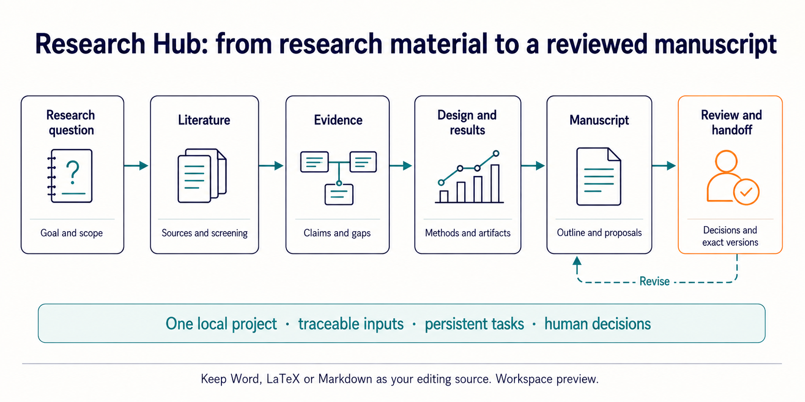
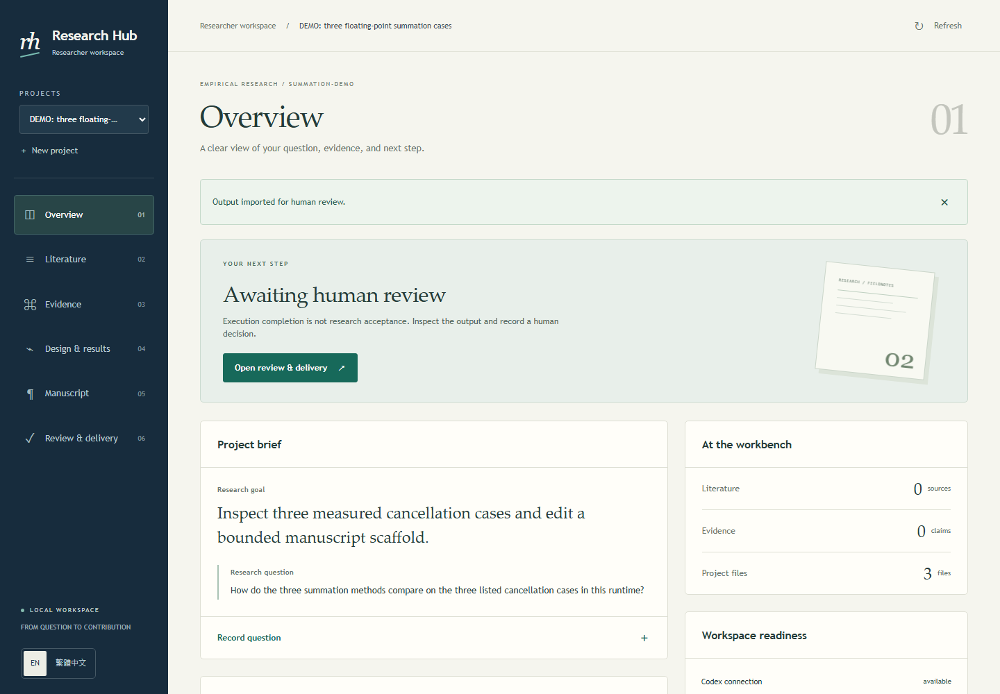
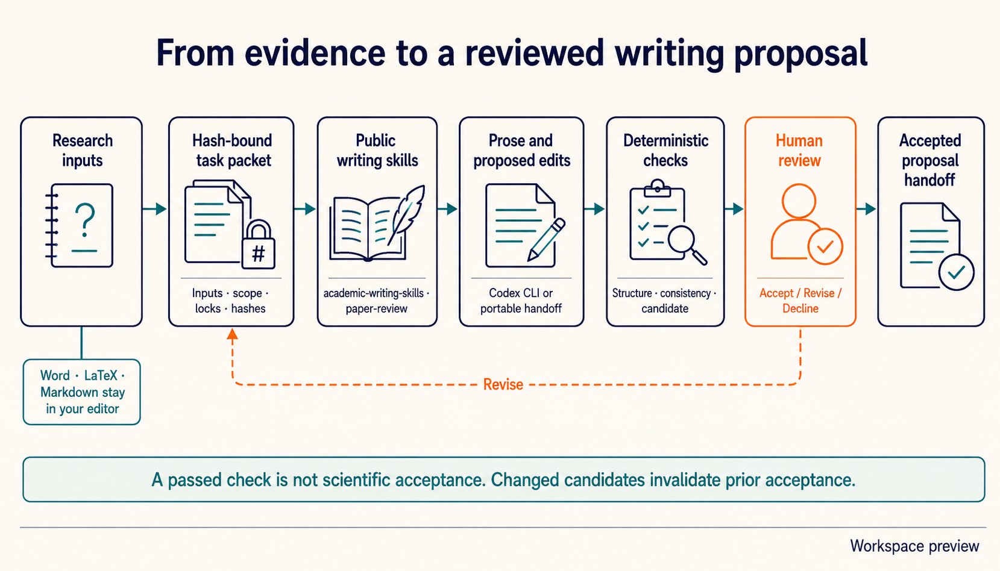

<!-- mcp-name: io.github.WenyuChiou/research-hub -->

# research-hub

A workspace on your computer for researchers to organize papers, evidence, and drafts, with AI-assisted proposals you review.

[繁體中文](README.zh-TW.md) · [Workspace guide](docs/workspace-guide.md) · [Setup guide](docs/setup.md) · [Developer architecture](docs/workspace-architecture.md)

[](https://pypi.org/project/research-hub-pipeline/) [](pyproject.toml) [](LICENSE)

## Why research-hub?

Research is spread across papers, notes, analysis, and manuscripts. A new paper can change a question; an updated file can make a conclusion or section worth revisiting. research-hub gives researchers and AI assistants a local workspace to record those connections, hand off tasks, and review proposals before accepting them.

- **Keep context:** bring questions, sources, evidence, results, and manuscripts into one project rather than leaving them only in a conversation.
- **Track changes:** register file paths and a file fingerprint (hash) to help detect changes, then inspect work that may need review when inputs change.
- **Keep decisions human:** AI proposals require review; a local delivery requires separate approval.



## Install and get started

<a id="start-here"></a>
<a id="first-run-checklist"></a>
<a id="workspace-preview"></a>

### Try the local workspace

Start with the workspace below. If you only want to try the older published literature dashboard, see the separate option below.

You need Python 3.10+ and Git. These commands install a specific source revision and create teaching fixtures in a **new or empty** `workspace-demo` directory. The source workspace is separate from the PyPI release: a package version does not establish that the installed wheel contains current source features.

```sh
git clone -c core.autocrlf=false https://github.com/WenyuChiou/research-hub.git
cd research-hub
git fetch origin c1ab382e1bc4bfdb1d5df6a230d1ab4509a50d2a
git checkout --detach c1ab382e1bc4bfdb1d5df6a230d1ab4509a50d2a
```

Choose the block for your system. They call the virtual environment's Python directly, without activation or changing PowerShell execution policy. Dependency installation needs network access.

**macOS / Linux**

```sh
python3 -m venv .venv
./.venv/bin/python -m pip install -e .
./.venv/bin/python -m research_hub project demo --root ./workspace-demo --json
./.venv/bin/python -m research_hub serve --workspace --root ./workspace-demo
```

**Windows PowerShell**

One Windows test environment using the earlier `14ddc070` source encountered `WinError 5` during demo creation; its cause is not yet known. See [verification and environment notes](docs/readme-verification-history.md).

```powershell
py -3 -m venv .venv
.\.venv\Scripts\python.exe -m pip install -e .
.\.venv\Scripts\python.exe -m research_hub project demo --root ./workspace-demo --json
.\.venv\Scripts\python.exe -m research_hub serve --workspace --root ./workspace-demo
```

Open [http://127.0.0.1:8765/app/](http://127.0.0.1:8765/app/). The demo contains two teaching projects. In the **Projects** dropdown, choose `DEMO: three floating-point summation cases` (`summation-demo`) or `DEMO: floating-point reading and review outline` (`review-demo`), then open **Literature** to see the literature page. These are teaching inputs, not research findings, and need no account. Stop the foreground server with `Ctrl+C` when finished.

For your own files, go directly to [bring your own project](docs/workspace-guide.md#bring-your-own-project); the guide’s earlier installation pin is historical.

<a id="published-dashboard"></a>

<details>
<summary>Optional: try the older published literature dashboard</summary>

The [PyPI package](https://pypi.org/project/research-hub-pipeline/) provides the older literature dashboard, not the newer source workspace. For an account-free sample, this separate virtual environment and empty root were tested on Linux with Python 3.12:

```sh
python3 -m venv .dashboard-venv
./.dashboard-venv/bin/python -m pip install research-hub-pipeline==1.2.0
mkdir -p "$HOME/research-hub-preview"
RESEARCH_HUB_ROOT="$HOME/research-hub-preview" ./.dashboard-venv/bin/research-hub dashboard --sample
```

Use a new or empty `research-hub-preview` directory under HOME: the command creates `.research_hub` and `logs` there. It prints the generated temporary HTML path; open that path in your browser. The bare `dashboard --sample` failed in a fresh HOME without the root setting; see [verification notes](docs/readme-verification-history.md) for platform and browser limits. For real services, see [setup](docs/setup.md), the [dashboard tour](docs/dashboard-walkthrough.md), and [first 10 minutes](docs/first-10-minutes.md).

</details>

## Work in the workspace



*Historical demo capture, reviewed 2026-09-08; the current interface may differ.*

| Page | Example work |
|---|---|
| Overview | Review the research question, goal, and project context. |
| Literature | Collect sources and record reasons to include or exclude them. |
| Evidence | Link claims to sources and inspect unresolved support. |
| Design & results | Record methods, results, limitations, and supporting files. |
| Manuscript | Register Word, LaTeX, or Markdown and prepare outlines and revisions. |
| Review & delivery | Inspect proposals, record decisions, and prepare a local handoff. |

Your editor remains responsible for changes to original files; the workspace registers their paths and hashes. A resolvable identifier does not prove a source supports a claim: check the evidence and scientific judgments yourself.

## Discover literature

In a compatible AI tool (an AI host) that can load the research-hub skill and has search and reading tools, start with a concrete request, for example:

> Find literature on LLMs simulating human decisions; include original links, relevance, versions, and limits on available full text.

Then ask to focus on economic decisions and compare human baselines and evaluation methods. Review the sources, reading coverage, and open questions before deciding what to do next. Search snippets are not full-text reading. This research approach can be used independently of Hub; Zotero, Obsidian, NotebookLM, and Hub storage are optional. The Hub visual workspace and saved-result view do require Hub.

The native reader can organize supplied research summaries, source indexes, and bibliographies, and attach a PDF explicitly supplied by the user. The PDF is copied unchanged for download; that does not mean it was parsed, translated, verified, or read in full. The reader can display caller-supplied translations alongside original observations, labeled unverified; it does not generate translations or verify their accuracy. See the [native reader export guide](src/research_hub/skills_data/research-hub/references/native-discovery-export.md) for the supplied-translation format.

See [AI Research Skills](https://github.com/WenyuChiou/ai-research-skills), the [AI host support matrix](docs/ai-host-support.md), and [MCP/REST integration](docs/ai-integrations.md). The optional [saved-result contract](docs/contracts/native-discovery-view.md) describes what a Hub handoff stores and its platform boundaries.

## Write, review, and deliver



| Mode | How it works |
|---|---|
| Portable handoff | Export a task to your AI host, then import prose and candidate file hashes. Export leaves the task waiting for the agent. |
| Connected Codex | An authenticated, compatible Codex CLI uses an explicitly trusted public writing bundle to produce prose; the result waits for human review. |

The optional [writing setup](docs/workspace-guide.md#writing-adapter-preview) explains how to verify and configure the adapter. Connected Codex receives bounded text excerpts, not binary document contents. Use your editor for Word formatting, LaTeX compilation, and final document changes. Accepted proposals can be packaged into a local ZIP after separate approval; this does not authorize publication or cloud upload. Workspace approval does not automatically protect existing direct-write CLI, MCP, dashboard, or cloud tools. See [boundaries and recovery](docs/workspace-guide.md#boundaries-and-recovery).

## Optional integrations

<a id="connect-your-ai-host"></a>

- **Zotero:** manage references; the connection requires an API key and library ID.
- **Obsidian:** organize notes in a local vault, or begin with local files.
- **NotebookLM:** create source-based briefings; it requires browser sign-in and a working session. See [setup](docs/notebooklm.md) and [troubleshooting](docs/notebooklm-troubleshooting.md).
- **AI hosts:** connect through [MCP/REST](docs/ai-integrations.md) or portable skills; MCP requires the optional `[mcp]` extra.

Choose integrations as needed and run `./.venv/bin/python -m research_hub doctor` (macOS/Linux) or `.\.venv\Scripts\python.exe -m research_hub doctor` (Windows PowerShell) to inspect them individually. Setup or installation does not itself verify a service. The [setup guide](docs/setup.md) covers extras and credentials; see also [local file import](docs/import-folder.md), [EZproxy](docs/ezproxy.md), and the [live smoke checklist](docs/live-smoke.md).

<a id="credential-reference"></a>
<details>
<summary>Integration credentials and extras</summary>

The local workspace demo needs none of these credentials. Existing personas use optional extras: Researcher and Humanities `[playwright,secrets]`; Analyst and Internal KM `[import,secrets]`.

<!-- env-vars-table-start -->

| Name | Required | Purpose |
|---|---|---|
| `ZOTERO_API_KEY` | Zotero only | Zotero API authentication |
| `ZOTERO_LIBRARY_ID` | Zotero only | Zotero library identifier |
| `SEMANTIC_SCHOLAR_API_KEY` | no | Optional search API key |
| `SEMANTIC_SCHOLAR_RPS` | no | Optional search request-rate override |
| `TAVILY_API_KEY` | no | Optional web search backend |
| `BRAVE_API_KEY` | no | Optional web search backend |

<!-- env-vars-table-end -->

</details>

## Documentation and contributing

- [Workspace guide](docs/workspace-guide.md) · [Workspace architecture](docs/workspace-architecture.md) · [Capability baseline](docs/capability-baseline.md) · [Verification history](docs/readme-verification-history.md)
- [CLI reference](docs/cli-reference.md) · [MCP tools](docs/mcp-tools.md) · [Stable API](docs/stable-api.md) · [File formats](docs/file-formats.md) · [Workflow runtime](docs/workflow-runtime.md) · [OpenWiki](openwiki/quickstart.md)
- [Recorded dashboard demo](docs/images/dashboard-walkthrough.gif) · [Full-resolution video](docs/demo/dashboard-walkthrough.mp4) · [MCP flow diagram](docs/images/research-hub-cover.png)
- [Contributing](CONTRIBUTING.md) · [Changelog](CHANGELOG.md) · [Release process](docs/RELEASING.md) · [MIT license](LICENSE)
