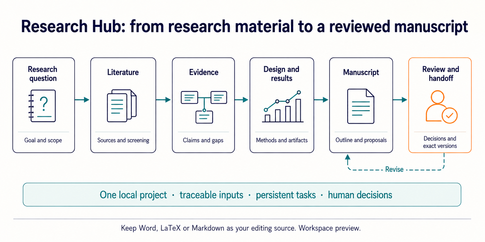
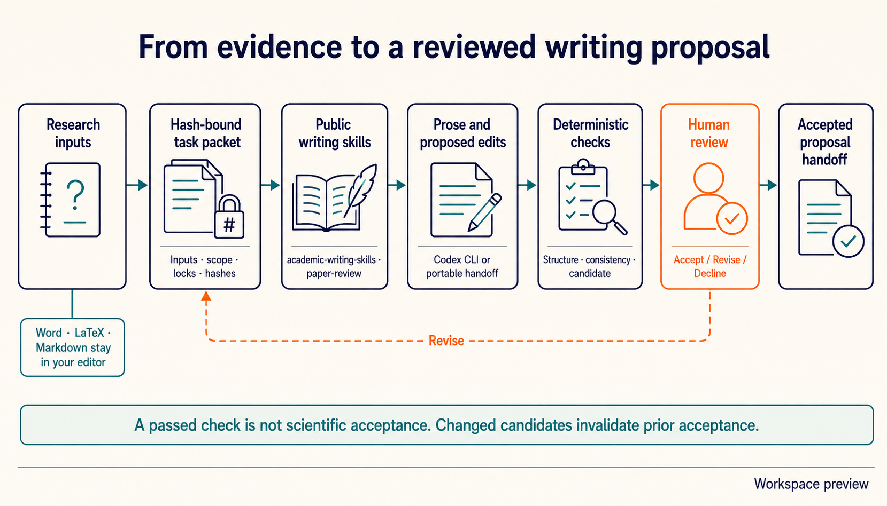

<!-- mcp-name: io.github.WenyuChiou/research-hub -->

# research-hub

Your local research workspace connecting AI assistants (Claude Code, Codex) with **Zotero** library status, **Obsidian** notes, **NotebookLM** source briefs, and human-reviewed manuscript drafts.

[繁體中文](README.zh-TW.md) · [Workspace guide](docs/workspace-guide.md) · [Setup guide](docs/setup.md) · [Developer architecture](docs/workspace-architecture.md)

[](https://pypi.org/project/research-hub-pipeline/) [](pyproject.toml) [](LICENSE)

## Why research-hub?

Literature discovery happens inside your AI host's conversation, while real research lives across Zotero libraries, Obsidian notes, NotebookLM briefs, analysis scripts, and manuscripts. `research-hub` turns those pieces into one inspectable local workspace—paired with [AI Research Skills](https://github.com/WenyuChiou/ai-research-skills) for Stage 1–2 discovery-to-synthesis:

- **Build on your AI host's native search:** Let Claude Code or Codex find and read papers using its own search and reading tools—no separate keyword scraper or lock-in required.
- **Organize literature visually & keep Zotero, Obsidian, and NotebookLM in view:** Browse every paper in a split Reading Desk or sortable Master Literature Table (with category overview cards, inline category & metadata notes, and Markdown/CSV export), inspect Zotero status, organize Obsidian cluster notes, and bundle verified sources for NotebookLM briefs.
- **Track changes & keep decisions human:** Register local file hashes to surface stale evidence or manuscript sections when inputs change; AI proposals and destination writes always wait for your approval.




*Actual local workspace UI captured from source revision `45c5fcc` using the offline account-free `review-demo` teaching project (with example category and relevance notes added).*

## Choose your starting path


1. **Start directly in your AI host (no Hub install needed):**
   - **Prerequisites:** Working search/reading tools in your host plus the [portable skill with its references](skills/research-hub/). No Hub installation, Zotero, Obsidian, or NotebookLM is required. See [skill loading](docs/setup.md#installed-skill-files) and [host support](docs/ai-host-support.md); Codex MCP is not release-verified.
   - **First request:** “Find papers on LLMs simulating human decisions. Include source links, relevance, versions, and actual reading limits.”
   - **Expected result:** Expect a source list in your host, with unknowns and unavailable tools/sources stated cleanly—never automatic full-text claims or unrequested writes.

2. **Use the Hub visual workspace (saved literature, master table, integrations & review):**
   - **Prerequisites:** Python 3.10+, Git, and a local browser.
   - [Install from source and launch in one command below](#workspace-preview) to inspect two offline seed references, test category curation and the Master Literature Table, and review reading limits. Optional [result saving](docs/contracts/native-discovery-view.md) and [task handoff](docs/workspace-guide.md#writing-adapter-preview) require a selected destination and authorization.

## Install and get started

<a id="start-here"></a>
<a id="first-run-checklist"></a>
<a id="workspace-preview"></a>

### Launch the local workspace

Clone the current source repository and launch the interactive workspace with `research-hub open --demo` (or omit `--demo` to start empty and click **Load sample project** in the browser). The source workspace is separate from the older published [PyPI package](https://pypi.org/project/research-hub-pipeline/), so a PyPI version number does not imply current source workspace features.

```sh
git clone -c core.autocrlf=false https://github.com/WenyuChiou/research-hub.git
cd research-hub
```

Install into a virtual environment and launch (dependency installation needs network access; running the local workspace demo needs no accounts or API keys):

**macOS / Linux**

```sh
python3 -m venv .venv
./.venv/bin/python -m pip install -e .
./.venv/bin/python -m research_hub open --demo
```

**Windows PowerShell**

```powershell
py -3 -m venv .venv
.\.venv\Scripts\python.exe -m pip install -e .
.\.venv\Scripts\python.exe -m research_hub open --demo
```

`open` creates `~/research-hub-workspace` (never overwriting an existing workspace) and opens [http://127.0.0.1:8765/app/](http://127.0.0.1:8765/app/) automatically. Pass `--root ./workspace-demo` to pick a specific directory, `--port 8766` if port `8765` is busy, or `serve --workspace --root ./workspace-demo` for explicit directory-only control. Keep the terminal running while using the workspace (`Ctrl+C` to stop).

**First task: inspect a saved source, check its reading limits, and organize it.**

1. Open [http://127.0.0.1:8765/app/](http://127.0.0.1:8765/app/) and, in **Projects**, choose `DEMO: floating-point reading and review outline` (`review-demo`).
2. Open **Literature**, then select **What Every Computer Scientist Should Know About Floating-Point Arithmetic**.
3. Expect two seed references in the list. The selected source shows DOI `10.1145/103162.103163`, **Unverified**, **Coverage unknown**, and **No summary saved**. These are expected demo states: no full text was downloaded or summarized, and supplied screening decisions are examples, not your review. Try expanding **Category & details** to assign a category, then click **Master table** to see the categorized overview and Markdown/CSV export.

For your own files, see [bring your own project](docs/workspace-guide.md#bring-your-own-project).

<details>
<summary>Verification scope, troubleshooting, and historical rehearsal notes</summary>

- **Verified scope:** The redesigned workspace UI, cold-start onboarding (`Load sample project`, `Category & details`, Master Literature Table, bilingual `EN`/`中` persistence), and screenshots above were verified locally on Windows 11 with Python 3.14 at source revision `45c5fcc`, alongside cross-platform CI (`ubuntu-latest`, `macos-latest`, `windows-latest`). The new `research-hub open` launcher is covered by unit tests across default creation, `--demo` preservation, and port-conflict handling. See [verification and historical evidence](docs/readme-verification-history.md) for exact scope and earlier pinned Linux rehearsals (`1f0726a7`, [2026-11-07 notes](docs/readme-verification-history.md#source-demo-first-task-2026-11-07)).
- **Second seed project:** `DEMO: three floating-point summation cases` (`summation-demo`) holds numerical examples and a manuscript scaffold with an empty Literature list; both projects are account-free teaching inputs.
- **Explicit directory mode:** If you prefer manual two-step setup, run `python -m research_hub project demo --root ./workspace-demo --json` followed by `python -m research_hub serve --workspace --root ./workspace-demo`. Do not recreate a demo over saved work.

</details>

<a id="published-dashboard"></a>

<details>
<summary>Optional: try the older published literature dashboard (PyPI 1.2.0)</summary>

The [PyPI package](https://pypi.org/project/research-hub-pipeline/) ships the older cluster dashboard rather than the current source workspace above. Tested on Linux with Python 3.12 in an empty `RESEARCH_HUB_ROOT` directory:

```sh
python3 -m venv .dashboard-venv
./.dashboard-venv/bin/python -m pip install research-hub-pipeline==1.2.0
mkdir -p "$HOME/research-hub-preview"
RESEARCH_HUB_ROOT="$HOME/research-hub-preview" ./.dashboard-venv/bin/research-hub dashboard --sample
```

Open the printed temporary HTML path in your browser. See [setup](docs/setup.md), the [dashboard tour](docs/dashboard-walkthrough.md), and [verification notes](docs/readme-verification-history.md) for service configuration and platform limits.

</details>

## What you can do in the workspace

| Page | Example work |
|---|---|
| Overview | Review the research question, goal, literature category breakdown, and project context. |
| Literature | Collect sources, edit categories and bibliographic notes (`Category & details`), screen papers, switch to the **Master table** (`Markdown`/`CSV` export), or browse read-only Obsidian Library metadata. |
| Evidence | Link claims to sources and inspect unresolved support. |
| Design & results | Record methods, results, limitations, and supporting files. |
| Manuscript | Register Word, LaTeX, or Markdown and prepare outlines and revisions. |
| Review & delivery | Inspect proposals, record human decisions, and prepare a local handoff. |

Your editor owns changes to original files; the workspace tracks paths and hashes. **Human review and evidence boundaries:** resolvable identifiers (DOIs, URLs) alone never prove scientific support; saving a source or screening note is not reading or verification; supplied PDFs and side-by-side translations are never automatically read, translated, or scientifically validated.

## Discover, organize, and verify literature

When you pair the [research-hub skill](skills/research-hub/) with a capable AI host (such as Claude Code or Codex), keep discovery on the host and let Research Hub handle deterministic storage and multi-destination handoffs:

- **Step 1 — Discover & read natively:** Ask your AI host to search, chain citations, and read accessible sections directly (e.g., *"Find literature on LLMs simulating human decisions; include original links, relevance, versions, and limits on available full text"*). Search snippets never count as full-text reading.
- **Step 2 — Organize locally or sync to Zotero & Obsidian:** Save project metadata via `project record` (and curate categories/notes in the visual workspace), or hand verified bibliographic records to `research-hub ingest` (after previewing `--dry-run`) to track **Zotero** status and generate structured **Obsidian** cluster notes.
- **Step 3 — Summarize & verify NotebookLM briefs:** Use `paper-summarize` for native seven-section full-text summaries (with optional Hub CLI save/generic Markdown stdout export at `231f9fbd+`, or abstract-only Obsidian/Zotero cluster note updates) and `research-hub notebooklm` + `notebooklm-brief-verifier` to generate and audit source-grounded briefs before moving downstream to `literature-triage-matrix` and `gap-to-topic`.

<details>
<summary>Native reader boundaries &amp; seven-section summary notes</summary>

- **Native reader scope:** Displays caller-supplied observations, bibliographies, unchanged PDF attachments, and supplied side-by-side translations (explicitly labeled unverified). It never auto-parses, translates, or scientifically validates content. See [native reader export guide](src/research_hub/skills_data/research-hub/references/native-discovery-export.md) and the optional [saved-result contract](docs/contracts/native-discovery-view.md).
- **Seven-section summary CLI boundary:** From source revision `231f9fbd` onward, the [authored source-summary CLI](docs/cli-reference.md#native-authored-source-summaries) saves and exports caller-authored seven-section summaries to generic Markdown stdout bound to current source hashes; this imports supplied content only and does not generate summaries, claim Obsidian/Roam import fidelity, establish scientific support, or record human acceptance. Read the [summary contract](docs/native-source-summary.md) first and verify your installed revision separately from package version numbers.

</details>

See [AI Research Skills](https://github.com/WenyuChiou/ai-research-skills), the [AI host support matrix](docs/ai-host-support.md), and [MCP/REST integration](docs/ai-integrations.md).

## Write, review, and deliver



| Mode | How it works |
|---|---|
| Portable handoff | Export a task to your AI host, then import prose and candidate file hashes. Export leaves the task waiting for the agent. |
| Connected Codex | An authenticated, compatible Codex CLI uses an explicitly trusted public writing bundle to produce prose; the result waits for human review. |

See [writing setup](docs/workspace-guide.md#writing-adapter-preview) and [boundaries and recovery](docs/workspace-guide.md#boundaries-and-recovery). Connected Codex receives bounded text excerpts, not binary files; formatting remains in your editor, and accepted proposals can be packaged into a local ZIP only after separate human approval (which does not authorize cloud upload or publication). Workspace approval does not automatically protect existing direct-write CLI, MCP, dashboard, or cloud tools.

## Optional integrations

<a id="connect-your-ai-host"></a>

- **Zotero:** Track library items and collection status (`ZOTERO_API_KEY` + `ZOTERO_LIBRARY_ID`).
- **Obsidian:** Organize per-cluster notes, deep summaries, and synthesis pages inside a local vault (or start from local Markdown).
- **NotebookLM:** Bundle clusters, generate briefings, and audit claims against sources (requires browser session; see [setup](docs/notebooklm.md) and [troubleshooting](docs/notebooklm-troubleshooting.md)).
- **AI hosts:** Connect via [MCP/REST](docs/ai-integrations.md) (requires `[mcp]`) or portable skills via [install guidance](docs/setup.md).

Run `./.venv/bin/python -m research_hub doctor` (macOS/Linux) or `.\.venv\Scripts\python.exe -m research_hub doctor` (Windows PowerShell) to inspect selected destinations individually. See [local file import](docs/import-folder.md), [EZproxy](docs/ezproxy.md), and the [live smoke checklist](docs/live-smoke.md).

<a id="credential-reference"></a>
<details>
<summary>Integration credentials and extras</summary>

The local workspace demo needs none of these credentials. Existing personas use optional extras: Researcher and Humanities `[playwright,secrets]`; Analyst and Internal KM `[import,secrets]`.

<!-- env-vars-table-start -->

| Name | Required | Purpose |
|---|---|---|
| `ZOTERO_API_KEY` | Zotero only | Zotero API authentication |
| `ZOTERO_LIBRARY_ID` | Zotero only | Zotero library identifier |
| `SEMANTIC_SCHOLAR_API_KEY` | no | Optional search API key |
| `SEMANTIC_SCHOLAR_RPS` | no | Optional search request-rate override |
| `TAVILY_API_KEY` | no | Optional web search backend |
| `BRAVE_API_KEY` | no | Optional web search backend |

<!-- env-vars-table-end -->

</details>

## Documentation and contributing

- [Workspace guide](docs/workspace-guide.md) · [Workspace architecture](docs/workspace-architecture.md) · [Capability baseline](docs/capability-baseline.md) · [Verification history](docs/readme-verification-history.md)
- [CLI reference](docs/cli-reference.md) · [MCP tools](docs/mcp-tools.md) · [Stable API](docs/stable-api.md) · [File formats](docs/file-formats.md) · [Workflow runtime](docs/workflow-runtime.md) · [OpenWiki](openwiki/quickstart.md)
- [Recorded dashboard demo](docs/images/dashboard-walkthrough.gif) · [Full-resolution video](docs/demo/dashboard-walkthrough.mp4) · [MCP flow diagram](docs/images/research-hub-cover.png)
- [Contributing](CONTRIBUTING.md) · [Changelog](CHANGELOG.md) · [Release process](docs/RELEASING.md) · [MIT license](LICENSE)
