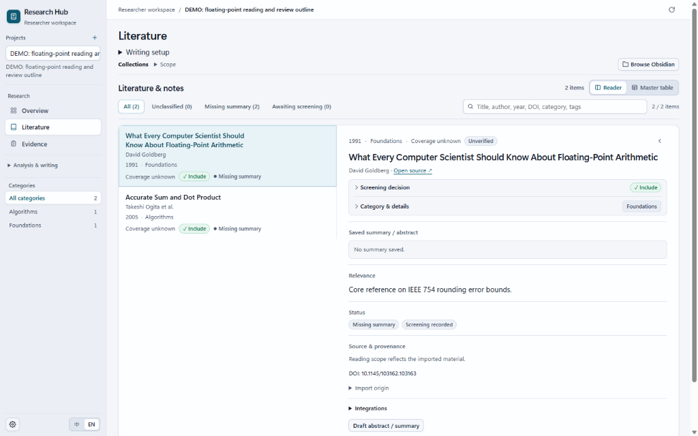
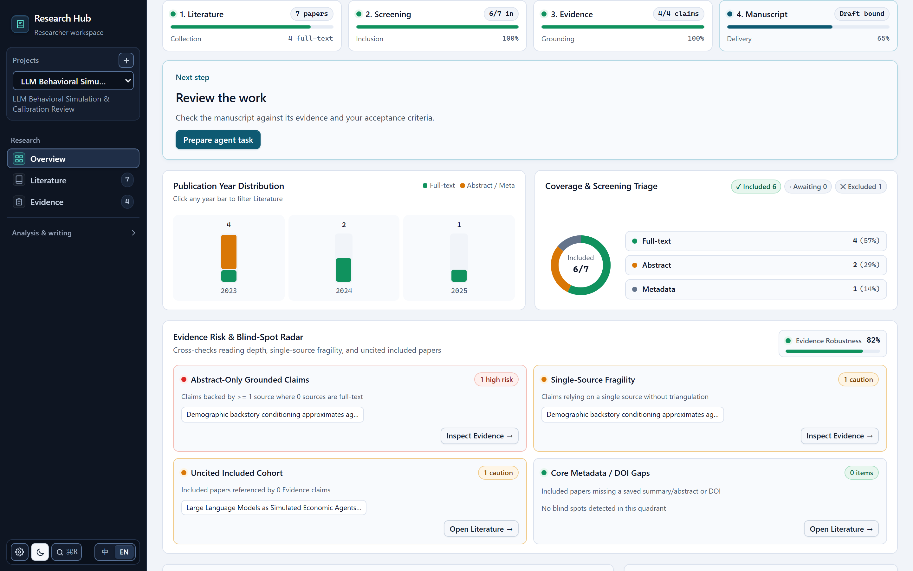

<!-- mcp-name: io.github.WenyuChiou/research-hub -->

# research-hub

**Local-First, Evidence-Grounded Research Workstation** connecting AI coding and research agents (**Claude Code**, **Codex**, **Antigravity** + [AI Research Skills](https://github.com/WenyuChiou/ai-research-skills)) with **Zotero**, **Obsidian (+ Bases)**, **NotebookLM**, and human-reviewed manuscripts.

[繁體中文](README.zh-TW.md) · [Workspace guide](docs/workspace-guide.md) · [Setup guide](docs/setup.md) · [Developer architecture](docs/workspace-architecture.md)

[](https://pypi.org/project/research-hub-pipeline/) [](pyproject.toml) [](LICENSE)

## Why research-hub?

AI chats are great at finding papers, yet real research lives across PDFs, Zotero collections, Obsidian vaults, NotebookLM briefs, analysis scripts, and drafts. `research-hub` anchors every AI-assisted step in one inspectable local SQLite + file ledger—separating saved metadata, declared AI reading scope, and human review decisions:


| Pillar | What you get in one local workstation |
|---|---|
| **AI Discovers, Hub Anchors Truth** | Let your AI host search and read natively while Hub tracks explicit reading scope (`Full-text` · `Abstract-only` · `Metadata`), screening (`Include` · `Exclude`), GitHub-style scoped labels (`#domain:*`, `#method:*`, `#risk:*`), and SHA-256 file freshness. |
| **Visual Synthesis & Blind-Spot Radar** | Monitor a 4-stage pipeline stepper, interactive year and scope charts, an **Evidence Blind-Spot Radar** (flagging abstract-only claims, single-source fragility, and uncited included papers), and a **Literature × Theme/Evidence Matrix**. |
| **Zero-Account Core + Sync Hooks** | Launch offline in 30 seconds (`research-hub open --demo`) with zero API keys, then trigger optional 1-click hooks for **Zotero** (dry-run dedup → sync), **Obsidian** (`.md` + `.base` views + `obsidian://` open), **NotebookLM** (source-bounded packs), and **BibTeX / RIS / CSL-JSON / APA 7th**. |
| **Human-in-the-Loop Writing & Ergonomics** | Every AI proposal and destination write waits for explicit human approval; work comfortably in calibrated **Light / Dark / System** themes with an instant `Ctrl+K` (`⌘K`) Command Palette and `EN` / `中` switching. |

## Visual workstation showcase



*Hero capture (`review-demo`, source commit `b2ca1ad`): account-free offline teaching project with example `Foundations` / `Algorithms` categories, scoped labels, and relevance notes; Goldberg (1991) truthfully displays `Unverified`, `Coverage unknown`, and `No summary saved`.*

| Light Overview + Blind-Spot Radar | Dark Reading Desk + Quick Cite Bar |
|---|---|
|  |  |
| **Pipeline Stepper & Radar:** Tracks Literature → Screening → Evidence → Manuscript progress and flags abstract-only grounding, single-source fragility, and uncited included papers. | **Calibrated Dark Reading Desk:** Inspect reading depth (`Full text` · `Abstract only` · `Metadata only`), filter by `#domain:*` / `#method:*` / `#risk:*` chips, and copy APA or BibTeX citations in one click. |
| **Literature × Theme & Evidence Matrix** | **Categorized Settings + Connected Sync Hub** |
|  |  |
| **Synthesis Matrix:** Cross-tabulates cohort papers against scope, screening decisions, evidence citation counts, and top scoped theme columns to expose synthesis gaps at a glance. | **Settings & Sync Hub:** Manage optional credentials, Light/Dark/System themes, local **NotebookLM** packs, **Zotero** dry-run sync, **Obsidian** `.md + .base` exports, and `.bib` / `.ris` / `CSL-JSON` / `APA 7th` outputs. |

*Showcase provenance (`b2ca1ad`): captured from an isolated 7-paper offline showcase fixture (`llm-decision-showcase`) using public bibliographic metadata, illustrative scope/screening/claim links, and local NotebookLM / Obsidian bundle exports—not live cloud provider writes or a completed scientific review.*

## Choose your starting path


1. **Start directly in your AI host (no Hub install needed):**
   - **Prerequisites:** Working search/reading tools in your host plus the [portable skill with its references](skills/research-hub/). No Hub installation, Zotero, Obsidian, or NotebookLM is required. See [skill loading](docs/setup.md#installed-skill-files) and [host support](docs/ai-host-support.md); Codex MCP is not release-verified.
   - **First request:** “Find papers on LLMs simulating human decisions. Include source links, relevance, versions, and actual reading limits.”
   - **Expected result:** Expect a source list in your host, with unknowns and unavailable tools/sources stated cleanly—never automatic full-text claims or unrequested writes.

2. **Use the Hub visual workspace (saved literature, master table, matrix, integrations & review):**
   - **Prerequisites:** Python 3.10+, Git, and a local browser.
   - [Install from source and launch in one command below](#workspace-preview) to inspect two offline seed references, test category curation, the Master Literature Table, and the Synthesis Matrix, and review reading limits. Optional [result saving](docs/contracts/native-discovery-view.md) and [task handoff](docs/workspace-guide.md#writing-adapter-preview) require a selected destination and authorization.

## Install and get started

<a id="start-here"></a>
<a id="first-run-checklist"></a>
<a id="workspace-preview"></a>

### 60-second local quickstart

Clone the source repository and launch the interactive workstation with `research-hub open --demo` (or omit `--demo` to start empty and click **Load sample project** in the browser). Note: the source workstation is separate from the older published [PyPI package](https://pypi.org/project/research-hub-pipeline/), so a PyPI version number does not imply current source workspace features.

```sh
git clone -c core.autocrlf=false https://github.com/WenyuChiou/research-hub.git
cd research-hub
```

Install into a virtual environment and launch (dependency installation needs network access; running the local demo needs zero accounts or API keys):

**macOS / Linux**

```sh
python3 -m venv .venv
./.venv/bin/python -m pip install -e .
./.venv/bin/python -m research_hub open --demo
```

**Windows PowerShell**

```powershell
py -3 -m venv .venv
.\.venv\Scripts\python.exe -m pip install -e .
.\.venv\Scripts\python.exe -m research_hub open --demo
```

`open` creates `~/research-hub-workspace` (never overwriting existing data) and opens [http://127.0.0.1:8765/app/](http://127.0.0.1:8765/app/) automatically. Pass `--root ./workspace-demo` to pick a folder, `--port 8766` if port `8765` is busy, or `serve --workspace --root ./workspace-demo` for explicit directory-only control (`Ctrl+C` to stop).

**First task: inspect a saved source, check its reading limits, and organize it.**

1. Open [http://127.0.0.1:8765/app/](http://127.0.0.1:8765/app/) and, in **Projects**, choose `DEMO: floating-point reading and review outline` (`review-demo`).
2. Open **Literature**, then select **What Every Computer Scientist Should Know About Floating-Point Arithmetic**.
3. Expect two seed references in the list. The selected source shows DOI `10.1145/103162.103163`, **Unverified**, **Coverage unknown**, and **No summary saved**. These are expected demo states: no full text was downloaded or summarized, and supplied screening decisions are examples, not your review. Expand **Category & details** to add categories or `#domain:*` labels, switch between **Reader**, **Master table**, and **Matrix**, or press `Ctrl+K` (`⌘K`) to jump across pages and papers.

To work with your own manuscripts and data, see [bring your own project](docs/workspace-guide.md#bring-your-own-project).

<details>
<summary>Verification scope, manual two-step mode, and historical rehearsal notes</summary>

- **Verified scope:** The upgraded workstation UI (HD brand emblems, Light/Dark/System themes, Settings Center, Sync Hub, Overview Radar, Synthesis Matrix, and `Ctrl+K` palette) and screenshots above were verified locally on Windows 11 at source commit `b2ca1ad` (building on `45c5fcc`), alongside cross-platform CI (`ubuntu-latest`, `macos-latest`, `windows-latest`). See [verification and historical evidence](docs/readme-verification-history.md) for exact capture provenance and earlier Linux rehearsals (`1f0726a7`, [2026-11-07 notes](docs/readme-verification-history.md#source-demo-first-task-2026-11-07)).
- **Second seed project:** `DEMO: three floating-point summation cases` (`summation-demo`) holds numerical examples and a manuscript scaffold with an empty Literature list; both projects are account-free teaching inputs.
- **Explicit directory mode:** Run `python -m research_hub project demo --root ./workspace-demo --json` followed by `python -m research_hub serve --workspace --root ./workspace-demo`. Never recreate a demo over saved work.

</details>

<a id="published-dashboard"></a>

<details>
<summary>Optional: try the older published cluster dashboard (PyPI 1.2.0)</summary>

The [PyPI package](https://pypi.org/project/research-hub-pipeline/) ships the earlier cluster HTML dashboard rather than the current source workstation above. Tested on Linux with Python 3.12 in an empty `RESEARCH_HUB_ROOT` directory:

```sh
python3 -m venv .dashboard-venv
./.dashboard-venv/bin/python -m pip install research-hub-pipeline==1.2.0
mkdir -p "$HOME/research-hub-preview"
RESEARCH_HUB_ROOT="$HOME/research-hub-preview" ./.dashboard-venv/bin/research-hub dashboard --sample
```

Open the printed temporary HTML path in your browser. See [setup](docs/setup.md), the [dashboard tour](docs/dashboard-walkthrough.md), and [verification notes](docs/readme-verification-history.md) for service configuration and platform limits.

</details>

## Inside the six-page workstation

| Page | Core workflow |
|---|---|
| **Overview** | Track the 4-stage pipeline stepper, publication year histogram, scope/triage donut, and **Evidence Blind-Spot Radar** alongside your research question. |
| **Literature** | Switch seamlessly across **Reader**, **Master table** (`Markdown` / `CSV` export), and **Matrix**; curate scoped `#` labels, copy APA/BibTeX citations, or inspect read-only Obsidian snapshots. |
| **Evidence** | Bind claims to registered source IDs and surface abstract-only or single-source support gaps before drafting. |
| **Design & results** | Record methods, measured outputs, limitations, and SHA-256-tracked analysis artifacts. |
| **Manuscript** | Register Word, LaTeX, or Markdown files, monitor input-hash freshness, and prepare section outlines or revisions. |
| **Review & delivery** | Audit AI proposals, record explicit human accept/revise decisions, and package approved local handoff archives. |

Your editor always owns original files; the workspace records paths and SHA-256 hashes. **Evidence boundaries:** resolvable DOIs or URLs never prove scientific support; saving a source or screening tag is not reading or verification; supplied PDFs and side-by-side translations are never silently parsed, translated, or validated.

## Agentic discovery, curation, and writing workflow

Pair the [research-hub skill](skills/research-hub/) and [AI Research Skills](https://github.com/WenyuChiou/ai-research-skills) with Claude Code, Codex, or Antigravity so your agent handles open-ended search while Hub enforces deterministic provenance:

- **1. Discover & read on your AI host:** Ask your host to search, trace citations, and read accessible text directly, reporting exact reading limits (search snippets never count as full-text reading).
- **2. Curate locally & sync on demand:** Save records via `project record` or the visual Reading Desk, preview **Zotero** deduplication via `--dry-run` / Sync Hub, and generate **Obsidian** Markdown notes + `.base` database views.
- **3. Summarize, audit briefs & draft with human review:** Author native seven-section full-text summaries with `paper-summarize` (readable prose in your host by default, or optionally hash-bound to saved workspace sources via `native-summary-context` / `native-summary-import` at `231f9fbd+`), bundle verified sources for **NotebookLM** (`notebooklm-brief-verifier`), and run bounded manuscript tasks where every proposal waits for your review.


| Writing mode | How proposals stay under human control |
|---|---|
| **Portable handoff** | Export a hash-pinned task packet to any AI host, then import candidate prose and file hashes back into `awaiting_human` review. |
| **Connected Codex** | An authenticated, compatible Codex CLI runs against an explicitly verified public writing bundle using bounded text excerpts (never binary files) and waits for human approval. |

<details>
<summary>Native reader, seven-section summary CLI, and delivery approval boundaries</summary>

- **Native reader scope:** Displays caller-supplied observations, bibliographies, unchanged PDF attachments, and supplied side-by-side translations (explicitly labeled unverified) without auto-parsing or scientific validation. See [native reader export guide](src/research_hub/skills_data/research-hub/references/native-discovery-export.md) and [saved-result contract](docs/contracts/native-discovery-view.md).
- **Seven-section summary CLI (`231f9fbd+`):** The [authored source-summary CLI](docs/cli-reference.md#native-authored-source-summaries) saves and exports caller-authored seven-section summaries to generic Markdown stdout bound to current source hashes; read the [summary contract](docs/native-source-summary.md) first and verify your installed revision separately from package version numbers.
- **Writing & delivery scope:** See [writing setup](docs/workspace-guide.md#writing-adapter-preview), [boundaries and recovery](docs/workspace-guide.md#boundaries-and-recovery), [AI host support](docs/ai-host-support.md), and [MCP/REST integration](docs/ai-integrations.md). Accepted proposals can be packaged into a local ZIP only after separate interactive human confirmation (not cloud upload or journal submission), and workspace approval does not automatically gate legacy direct-write CLI, MCP, dashboard, or cloud commands.

</details>

## Optional integrations and credentials

<a id="connect-your-ai-host"></a>

| Integration | Setup in `⚙ Settings` or CLI | Connected UI Sync Hook |
|---|---|---|
| **Zotero** | Save `ZOTERO_LIBRARY_ID` + encrypted `ZOTERO_API_KEY` in **`⚙ Settings → Connections & Sync`** (UI config overrides ambient `ZOTERO_*` env vars) and test Web / Local API status | **Dry-run dedup preview** → **Confirm Write to Zotero** (auto-creates `[Research Hub] <Project>` collection + direct Zotero URL) or `.ris` export |
| **Obsidian (+ Bases)** | Launch with `--obsidian-vault` or save Vault path directly in **`⚙ Settings`** (unified read-only Vault validation + Literature Vault browsing without separate snapshot config; `--library-snapshot` optional) | Generate bounded `.md` literature notes + `.base` views under `.research/exports/` and open via `obsidian://` |
| **NotebookLM** | Import an existing `state.json` or sign in via `notebooklm login --auto-detect`, then run **Check NotebookLM session** | Build evidence-bounded **NotebookLM source packs** and trigger **`☁ Upload to NotebookLM`** with `upload_receipt.json` verification |
| **AI Assistant & citations** | Open **`✦ AI Assistant`** (`Ctrl+J` / `⌘J`, supporting Fast Commander + `Claude` / `Codex` / `Gemini`) or attach [MCP/REST](docs/ai-integrations.md) | Curate/delete/restore/tag papers via two-step human-confirmed chat plans, or copy **APA 7th** / **BibTeX** citations |

Run `./.venv/bin/python -m research_hub doctor` (macOS/Linux) or `.\.venv\Scripts\python.exe -m research_hub doctor` (Windows PowerShell) to inspect configured destinations individually. See [local file import](docs/import-folder.md), [EZproxy](docs/ezproxy.md), and the [live smoke checklist](docs/live-smoke.md).

<a id="credential-reference"></a>
<details>
<summary>Environment variables and optional package extras</summary>

The local workstation demo requires none of these credentials. Existing personas use optional extras: Researcher and Humanities `[playwright,secrets]`; Analyst and Internal KM `[import,secrets]`.

<!-- env-vars-table-start -->

| Name | Required | Purpose |
|---|---|---|
| `ZOTERO_API_KEY` | Zotero only | Zotero API authentication |
| `ZOTERO_LIBRARY_ID` | Zotero only | Zotero library identifier |
| `SEMANTIC_SCHOLAR_API_KEY` | no | Optional search API key |
| `SEMANTIC_SCHOLAR_RPS` | no | Optional search request-rate override |
| `TAVILY_API_KEY` | no | Optional web search backend |
| `BRAVE_API_KEY` | no | Optional web search backend |

<!-- env-vars-table-end -->

</details>

## Documentation and contributing

- [Workspace guide](docs/workspace-guide.md) · [Workspace architecture](docs/workspace-architecture.md) · [Capability baseline](docs/capability-baseline.md) · [Verification history](docs/readme-verification-history.md)
- [CLI reference](docs/cli-reference.md) · [MCP tools](docs/mcp-tools.md) · [Stable API](docs/stable-api.md) · [File formats](docs/file-formats.md) · [Workflow runtime](docs/workflow-runtime.md) · [OpenWiki](openwiki/quickstart.md)
- [Recorded dashboard demo](docs/images/dashboard-walkthrough.gif) · [Full-resolution video](docs/demo/dashboard-walkthrough.mp4) · [MCP flow diagram](docs/images/research-hub-cover.png)
- [Contributing](CONTRIBUTING.md) · [Changelog](CHANGELOG.md) · [Release process](docs/RELEASING.md) · [MIT license](LICENSE)
