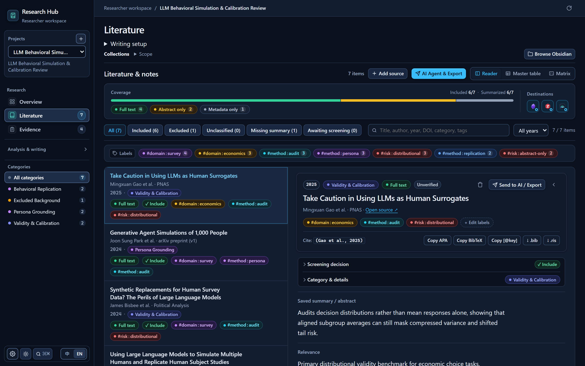
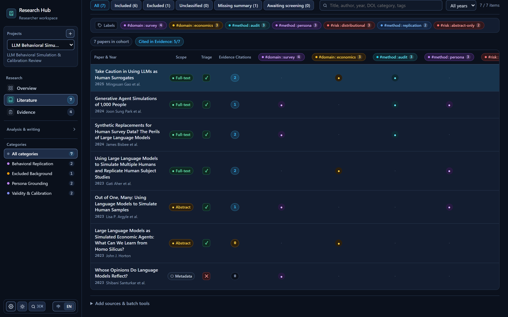
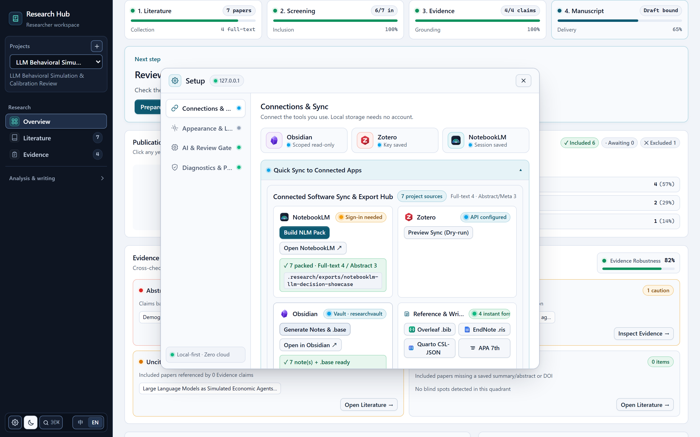

<!-- mcp-name: io.github.WenyuChiou/research-hub -->

# research-hub

**Local-First, Evidence-Grounded Research Workstation** connecting AI agents (**Claude Code**, **Codex**, **Gemini**, **Antigravity** + [AI Research Skills](https://github.com/WenyuChiou/ai-research-skills)) with **Zotero**, **Obsidian (+ Bases)**, **NotebookLM**, and human-reviewed drafts.

[繁體中文](README.zh-TW.md) · [Workspace guide](docs/workspace-guide.md) · [Setup guide](docs/setup.md) · [Architecture](docs/workspace-architecture.md)

[](https://pypi.org/project/research-hub-pipeline/) [](pyproject.toml) [](LICENSE)

## Why research-hub?

Real research spans PDFs, Zotero, Obsidian, NotebookLM, analysis code, and drafts. `research-hub` keeps one local SQLite + SHA-256 ledger separating **saved metadata**, **declared reading scope**, and **human decisions**—with zero forced cloud lock-in.


| Core pillar | What you get |
|---|---|
| **Honest Evidence Boundaries** | Track explicit scope (`Full-text` · `Abstract-only` · `Metadata`), screening (`Include` · `Exclude`), GitHub-style `#domain:*` / `#method:*` / `#risk:*` chips, and SHA-256 freshness. |
| **Visual Synthesis & Blind-Spot Radar** | Monitor pipeline progress, year/scope charts, an **Evidence Blind-Spot Radar**, and a 2D **Literature × Theme/Evidence Matrix**. |
| **Zero-Account Core + 3-Way Sync** | Run offline in 30s (`research-hub open --demo`), or trigger 1-click **Zotero** collections sync, **Obsidian** `.md + .base` views, **NotebookLM** cloud packs, and `.bib` / `.ris` / `CSL-JSON` / `APA 7th`. |
| **AI Assistant & Ergonomics** | Propose edits via **`✦ AI Assistant`** (`Ctrl+J` / `⌘J`) with confirm-before-write plans, switch **Light / Dark / System** themes, and jump anywhere with `Ctrl+K` (`⌘K`). |

## Visual workstation


| Overview + Blind-Spot Radar | Dark Reading Desk + Quick Cite |
|---|---|
|  |  |
| Spot abstract-only grounding, single-source fragility, and uncited included papers at a glance. | Inspect reading depth, filter by scoped `#` labels, and copy APA or BibTeX in one click. |
| **Literature × Theme & Evidence Matrix** | **Settings Center + Sync Hub** |
|  |  |
| Cross-tabulate cohort papers against scope, citations, and top theme tags to expose synthesis gaps. | Manage encrypted keys, themes, live status LEDs, NotebookLM / Zotero / Obsidian sync, and standard exports. |

## Choose your starting path


- **Path A — Directly inside your AI host (zero install):** Load the [portable skill](skills/research-hub/) ([skill loading](docs/setup.md#installed-skill-files) · [host support](docs/ai-host-support.md)). No Hub installation, Zotero, Obsidian, or NotebookLM is required; Codex MCP is not release-verified. Ask: *“First request: Find papers on LLMs simulating human decisions. Include links, relevance, versions, and reading limits.”* Expect a source list in your host stating unknowns cleanly without claiming full text.
- **Path B — Visual Research Hub workstation:** Requires Python 3.10+, Git, and a local browser. [Launch in one command below](#workspace-preview) to explore offline sample papers, Master Table, Matrix, and citations; optional [result saving](docs/contracts/native-discovery-view.md) and [task handoff](docs/workspace-guide.md#writing-adapter-preview) use only a selected destination and authorization.

## Install and get started

<a id="start-here"></a>
<a id="first-run-checklist"></a>
<a id="workspace-preview"></a>

Launch from source for the full interactive workstation, or install from [PyPI](https://pypi.org/project/research-hub-pipeline/) (`pip install -U research-hub-pipeline`) after release `1.3.0+`.

```sh
git clone -c core.autocrlf=false https://github.com/WenyuChiou/research-hub.git
cd research-hub
```

**macOS / Linux**

```sh
python3 -m venv .venv
./.venv/bin/python -m pip install -e .
./.venv/bin/python -m research_hub open --demo
```

**Windows PowerShell**

```powershell
py -3 -m venv .venv
.\.venv\Scripts\python.exe -m pip install -e .
.\.venv\Scripts\python.exe -m research_hub open --demo
```

`open` opens [http://127.0.0.1:8765/app/](http://127.0.0.1:8765/app/) on `~/research-hub-workspace` (never overwriting existing data; pass `--root`, `--port`, or `--obsidian-vault`, or use `serve --workspace --root ./workspace-demo`).

**First 60-second walkthrough:**

1. Choose `DEMO: floating-point reading and review outline` (`review-demo`) in **Projects**.
2. Open **Literature** and click **What Every Computer Scientist Should Know About Floating-Point Arithmetic**.
3. Verify the two seed sources display DOI `10.1145/103162.103163` alongside **Unverified**, **Coverage unknown**, and **No summary saved**—then test labels, Master Table, Matrix, or `Ctrl+K` (`⌘K`). See [bring your own project](docs/workspace-guide.md#bring-your-own-project) when ready.

<details>
<summary>Verification scope, capture provenance & manual two-step mode</summary>

- **Capture provenance:** Workstation showcase shots were captured on Windows 11 (`b2ca1ad` / `45c5fcc`) against offline fixtures (`review-demo`, `llm-decision-showcase`); `summation-demo` provides a numerical scaffold with an empty Literature list. Cross-platform CI and historical Linux rehearsals (`2026-11-07`) are documented in [verification history](docs/readme-verification-history.md#source-demo-first-task-2026-11-07).
- **Manual two-step launch:** Run `python -m research_hub project demo --root ./workspace-demo --json` followed by `python -m research_hub serve --workspace --root ./workspace-demo`.

</details>

<a id="published-dashboard"></a>

<details>
<summary>Optional: legacy cluster HTML dashboard (PyPI 1.2.0)</summary>

```sh
python3 -m venv .dashboard-venv
./.dashboard-venv/bin/python -m pip install research-hub-pipeline==1.2.0
mkdir -p "$HOME/research-hub-preview"
RESEARCH_HUB_ROOT="$HOME/research-hub-preview" ./.dashboard-venv/bin/research-hub dashboard --sample
```

See [setup](docs/setup.md) and the [dashboard tour](docs/dashboard-walkthrough.md) for standalone HTML dashboard usage.

</details>

## Six-page workstation & AI workflow

| Page | Role in your workflow |
|---|---|
| **Overview** | Pipeline stepper, publication timeline, scope donut, and **Evidence Blind-Spot Radar**. |
| **Literature** | **Reader**, **Master table** (`Markdown` / `CSV`), **Matrix**, `#` chips, APA/BibTeX copy, and read-only Obsidian vault notes. |
| **Evidence** | Bind claims to registered source IDs and surface abstract-only or single-source gaps. |
| **Design & results** | Record methods, outputs, limitations, and SHA-256-tracked analysis artifacts. |
| **Manuscript** | Track **Word**, **LaTeX**, or **Markdown** files, input-hash freshness, and revision outlines. |
| **Review & delivery** | Accept or revise AI writing proposals and package approved local handoff ZIPs. |


| AI Collaboration Mode | Human-in-the-loop guarantee |
|---|---|
| **Portable handoff** | Export a hash-pinned packet to Claude, Codex, or Antigravity, then import candidate prose to `awaiting_human`. |
| **Connected Codex / Assistant** | Propose bounded manuscript drafts or literature curations (`Ctrl+J`); every change waits for explicit confirmation. |

<details>
<summary>Evidence boundaries, native seven-section summaries & delivery guarantees</summary>

- **Zero silent overclaiming:** Resolvable DOIs never prove claim support; supplied PDFs and translations stay unparsed unless explicitly read.
- **Native summaries & reader:** Use [paper-summarize](skills/paper-summarize/) with [native summary CLI](docs/cli-reference.md#native-authored-source-summaries) (`native-summary-context` / `native-summary-import`, [contract](docs/native-source-summary.md)), and see [native reader export guide](src/research_hub/skills_data/research-hub/references/native-discovery-export.md).
- **Bounded delivery:** Accepted writing proposals package only into local ZIPs on confirmation ([writing guide](docs/workspace-guide.md#writing-adapter-preview) · [MCP/REST](docs/ai-integrations.md)).

</details>

## Integrations & documentation

<a id="connect-your-ai-host"></a>

| Integration | Quick setup (`⚙ Settings` or CLI) | One-click sync & output |
|---|---|---|
| **Zotero** | Save `ZOTERO_LIBRARY_ID` + encrypted `ZOTERO_API_KEY` (overrides ambient env vars) | **Dry-run preview** → attach/create `[Research Hub] <Project>` collection |
| **Obsidian (+ Bases)** | Pass `--obsidian-vault` or save Vault path in **Settings** (unified read-only validation + browsing) | Export `.md` notes + `.base` views under `.research/exports/` & open via `obsidian://` |
| **NotebookLM** | Sign in via `notebooklm login --auto-detect` or import `state.json` | Build bounded source packs & click **`☁ Upload to NotebookLM`** (`upload_receipt.json`) |
| **AI Assistant & MCP** | Press `Ctrl+J` (`⌘J`) or connect [MCP / REST](docs/ai-integrations.md) | Confirm natural-language curation, tagging, sync, or **APA / BibTeX / RIS / CSL** export |

<a id="credential-reference"></a>
<details>
<summary>Environment variables & optional extras (`research-hub doctor`)</summary>

Run `research-hub doctor` to inspect destination health. Optional extras: `[playwright,secrets]` (Researcher/Humanities) or `[import,secrets]` (Analyst/Internal KM).

<!-- env-vars-table-start -->

| Name | Required | Purpose |
|---|---|---|
| `ZOTERO_API_KEY` | Zotero only | Zotero API authentication |
| `ZOTERO_LIBRARY_ID` | Zotero only | Zotero library identifier |
| `SEMANTIC_SCHOLAR_API_KEY` | no | Optional search API key |
| `SEMANTIC_SCHOLAR_RPS` | no | Optional search request-rate override |
| `TAVILY_API_KEY` | no | Optional web search backend |
| `BRAVE_API_KEY` | no | Optional web search backend |

<!-- env-vars-table-end -->

</details>

- **Guides:** [Workspace guide](docs/workspace-guide.md) · [Architecture](docs/workspace-architecture.md) · [CLI](docs/cli-reference.md) · [MCP tools](docs/mcp-tools.md) · [Stable API](docs/stable-api.md) · [Capability baseline](docs/capability-baseline.md)
- **Project:** [Changelog](CHANGELOG.md) · [Upgrade guide](UPGRADE.md) · [Verification history](docs/readme-verification-history.md) · [Contributing](CONTRIBUTING.md) · [Releasing](docs/RELEASING.md) · [MIT License](LICENSE)
