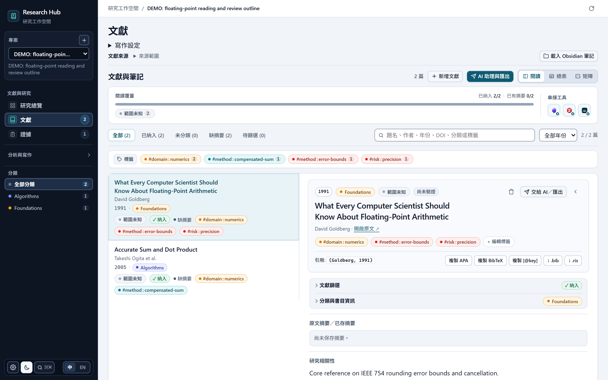
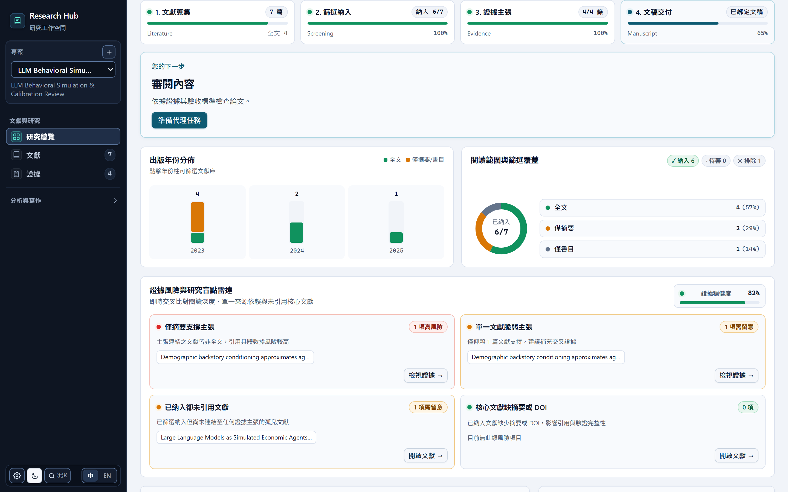

<!-- mcp-name: io.github.WenyuChiou/research-hub -->

# research-hub

**本機優先、證據錨定的研究工作台（Local-First, Evidence-Grounded Research Workstation）**：串聯 AI 程式與研究代理（**Claude Code**、**Codex**、**Antigravity** ＋ [AI Research Skills](https://github.com/WenyuChiou/ai-research-skills)）與 **Zotero**、**Obsidian（含 Bases）**、**NotebookLM** 及人工審閱的論文草稿。

繁體中文 · [English](README.md) · [工作區指南](docs/workspace-guide.zh-TW.md) · [安裝指南](docs/setup.md) · [開發者架構](docs/workspace-architecture.md)

[](https://pypi.org/project/research-hub-pipeline/) [](pyproject.toml) [](LICENSE)

## 為什麼使用 research-hub？

AI 對話擅長搜尋文獻線索，但真正的研究分散在 PDF 原文、Zotero 文獻庫、Obsidian 筆記庫、NotebookLM 簡報、分析腳本與論文稿件之間。`research-hub` 將每個 AI 輔助環節錨定在可檢視的本機 SQLite 與檔案雜湊帳本中，明確區分「已存書目」、「AI 實際閱讀範圍」與「人類審查決定」：


| 核心支柱 | 單一本機研究工作台提供的能力 |
|---|---|
| **AI 原生探索，本機錨定證據** | 讓 AI 主機使用原生搜尋與閱讀工具找文獻，由 Hub 明確標示閱讀範圍（`全文` · `僅摘要` · `僅書目`）、篩選狀態（`納入` · `排除`）、GitHub 風格結構化標籤（`#domain:*`、`#method:*`、`#risk:*`）與 SHA-256 檔案變動追蹤。 |
| **視覺化綜合與研究盲點雷達** | 即時掌握四階段流程進度條、出版年份與閱讀覆蓋圖表、**證據風險與研究盲點雷達**（自動標示僅摘要支撐主張、單一文獻脆弱依賴、已納入卻未引用文獻），以及 **文獻 × 主題／證據交叉矩陣（矩陣）**。 |
| **免帳號核心 ＋ 三端與書目同步** | 免 API 金鑰 30 秒離線啟動（`research-hub open --demo`）；需要時一鍵串接 **Zotero**（Dry-run 去重預覽 → 寫入）、**Obsidian**（`.md` 筆記 ＋ `.base` 資料庫檢視 ＋ `obsidian://` 開啟）、**NotebookLM**（限定來源匯入包）與 **BibTeX / RIS / CSL-JSON / APA 7th**。 |
| **人類主導寫作與雙主題工學** | 所有 AI 寫作提案與外部寫入皆須經人工審閱核准；內建精準校色的 **淺色／深色／跟隨系統** 主題、零延遲 `Ctrl+K`（`⌘K`）命令面板與 `中`／`EN` 雙語即時切換。 |

## 視覺化研究工作台總覽



*主畫面截圖（`review-demo`，原始碼版本 `b2ca1ad`）：免帳號離線教學專案，填入範例分類（`Foundations`、`Algorithms`）、結構化標籤與相關性筆記；Goldberg（1991）如實顯示「尚未驗證」、「範圍未知」與「尚未保存摘要」。*

| 淺色研究總覽 ＋ 證據盲點雷達 | 深色閱讀工作台 ＋ 一鍵引文列 |
|---|---|
|  |  |
| **四階段進度與盲點雷達：** 串聯「文獻蒐集 → 篩選納入 → 證據主張 → 文稿交付」，即時偵測僅摘要支撐主張、單一來源脆弱性與未引用核心文獻。 | **深色精讀介面與快速引文：** 一眼辨識 `全文` · `僅摘要` · `僅書目` 範圍，以 `#domain:*`／`#method:*`／`#risk:*` 篩選，並一鍵複製 APA 或 BibTeX 引文。 |
| **文獻 × 主題標籤與證據交叉矩陣（矩陣）** | **分類設定中心 ＋ 已連接軟體同步中樞** |
|  |  |
| **綜合交叉矩陣：** 將文獻清單對照閱讀深度、篩選結果、證據引用次數與高頻主題標籤，快速找出證據空白與研究脈絡。 | **設定中心與同步中樞：** 集中管理選用金鑰、淺色／深色主題、本機 **NotebookLM** 來源包、**Zotero** 預覽同步、**Obsidian** `.md + .base` 匯出與 `.bib`／`.ris`／`CSL-JSON`／`APA 7th`。 |

*展示畫面出處說明（`b2ca1ad`）：上方四張展示圖擷取自隔離環境中的 7 篇文獻離線示範專案（`llm-decision-showcase`），採用公開真實書目、示範用閱讀範圍／篩選／主張連結與本機 NotebookLM／Obsidian 封裝輸出，不代表外部雲端寫入驗收或已完成之科學文獻回顧。*

## 選擇你的起點


1. **直接在現有 AI 主機開始（免裝 Hub）：**
   - **前置條件：** 需要可用的搜尋與閱讀工具，以及[可攜式技能與參考檔案](skills/research-hub/)。不需要安裝 Hub，也不需要 Zotero、Obsidian 或 NotebookLM。請見[技能載入方式](docs/setup.md#installed-skill-files)與[主機支援表](docs/ai-host-support.md)；Codex MCP 尚未通過版本發布驗證。
   - **第一個請求：**「幫我找 LLM 模擬人類決策的文獻，列出來源連結、相關性、版本及實際讀取範圍。」
   - **預期成果：** 預期在主機中取得來源清單，明列未知資訊與不可用的工具或來源，不自動宣稱全文已讀，也不會未經要求寫入檔案。

2. **使用 Hub 視覺化工作區（保存書目、文獻總表、交叉矩陣、整合三端與審查）：**
   - **前置條件：** Python 3.10+、Git 及本機瀏覽器。
   - [依下方步驟安裝並以單一指令啟動](#workspace-preview)，檢視兩筆離線種子書目、體驗分類編輯、文獻總表與交叉矩陣，並確認讀取限制。選用的[成果保存](docs/contracts/native-discovery-view.md)與[任務交接](docs/workspace-guide.zh-TW.md#writing-adapter-preview)需要選定目的地與授權。

<a id="start-here"></a>
<a id="first-run-checklist"></a>

## 安裝與快速開始

<a id="workspace-preview"></a>

### 60 秒啟動本機工作台

下載最新原始碼並以 `research-hub open --demo` 一鍵啟動互動式工作台（若省略 `--demo`，則開啟空白工作區並可在瀏覽器點選**載入示範專案**）。注意：原始碼工作台與較早發布的 [PyPI 套件](https://pypi.org/project/research-hub-pipeline/)屬不同發布線，PyPI 版本號不代表包含最新原始碼工作區功能。

```sh
git clone -c core.autocrlf=false https://github.com/WenyuChiou/research-hub.git
cd research-hub
```

安裝至虛擬環境並啟動（安裝相依套件需連線網路；執行本機示範工作區不需要任何帳號或 API key）：

**macOS / Linux**

```sh
python3 -m venv .venv
./.venv/bin/python -m pip install -e .
./.venv/bin/python -m research_hub open --demo
```

**Windows PowerShell**

```powershell
py -3 -m venv .venv
.\.venv\Scripts\python.exe -m pip install -e .
.\.venv\Scripts\python.exe -m research_hub open --demo
```

`open` 會自動建立 `~/research-hub-workspace`（絕不覆蓋既有工作區資料）並開啟 [http://127.0.0.1:8765/app/](http://127.0.0.1:8765/app/)。可加 `--root ./workspace-demo` 指定目錄、埠號衝突時加 `--port 8766`，或改用 `serve --workspace --root ./workspace-demo` 手動指定目錄啟動（按 `Ctrl+C` 停止）。

**第一個任務：檢視已保存的來源、確認讀取限制並嘗試分類整理。**

1. 開啟 [http://127.0.0.1:8765/app/](http://127.0.0.1:8765/app/)，點左下角 **中** 切換繁體中文，再在**專案**選擇 `DEMO: floating-point reading and review outline`（`review-demo`）。
2. 開啟**文獻**，選取 **What Every Computer Scientist Should Know About Floating-Point Arithmetic**。
3. 清單應有兩筆種子書目。所選來源會顯示 DOI `10.1145/103162.103163`、**尚未驗證**、**範圍未知**及**尚未保存摘要**。這是預期的示範狀態：沒有下載或摘要全文，附帶的篩選決定只是範例，不是你的審查結果。可展開**分類與書目資訊**新增分類或 `#domain:*` 標籤、切換右上角**閱讀**／**總表**／**矩陣**，或按 `Ctrl+K`（`⌘K`）快速跳轉頁面與文獻。

要管理自己的研究檔案，請見[使用自己的專案](docs/workspace-guide.zh-TW.md#使用自己的專案)。

<details>
<summary>驗證範圍、手動兩步驟啟動與歷史試跑紀錄</summary>

- **已驗證範圍：** 上述升級版工作台介面（高解析度品牌標誌、淺色／深色／系統主題、分類設定中心、同步中樞、研究總覽盲點雷達、綜合交叉矩陣與 `Ctrl+K` 命令面板）與截圖已於 Windows 11 針對原始碼版本 `b2ca1ad`（延續 `45c5fcc` 基礎）實機驗證，並搭配跨平台 CI（`ubuntu-latest`、`macos-latest`、`windows-latest`）。完整擷取脈絡與較早固定版本（`1f0726a7`，[2026-11-07 紀錄](docs/readme-verification-history.md#source-demo-first-task-2026-11-07)）詳見[驗證與歷史紀錄](docs/readme-verification-history.md)。
- **第二個種子專案：** `DEMO: three floating-point summation cases`（`summation-demo`）包含數值範例與稿件骨架，文獻清單為空；兩個示範都不需要帳號。
- **手動兩步驟啟動：** 可先執行 `python -m research_hub project demo --root ./workspace-demo --json`，再執行 `python -m research_hub serve --workspace --root ./workspace-demo`。請勿在已有資料的目錄重建示範。

</details>

<a id="published-dashboard"></a>

<details>
<summary>選用：試用已發布的舊版文獻群組儀表板（PyPI 1.2.0）</summary>

[PyPI 套件](https://pypi.org/project/research-hub-pipeline/)提供較早的文獻群組 HTML 儀表板，而非上方的新版原始碼工作台。以下步驟已在 Linux、Python 3.12 搭配空白 `RESEARCH_HUB_ROOT` 目錄測試：

```sh
python3 -m venv .dashboard-venv
./.dashboard-venv/bin/python -m pip install research-hub-pipeline==1.2.0
mkdir -p "$HOME/research-hub-preview"
RESEARCH_HUB_ROOT="$HOME/research-hub-preview" ./.dashboard-venv/bin/research-hub dashboard --sample
```

在瀏覽器開啟程式印出的暫存 HTML 路徑。服務設定與平台限制請見[安裝指南](docs/setup.md)、[儀表板導覽](docs/dashboard-walkthrough.md)與[驗證紀錄](docs/readme-verification-history.md)。

</details>

## 六頁研究工作台核心能力

| 頁面 | 核心工作流程 |
|---|---|
| **研究總覽** | 檢視四階段流程進度條、出版年份直方圖、閱讀範圍與篩選圓環圖，以及**證據風險與研究盲點雷達**。 |
| **文獻** | 在**閱讀**、**總表**（`Markdown`／`CSV` 匯出）與**矩陣**間切換；編輯 `#` 結構化標籤、一鍵複製 APA／BibTeX 引文，或瀏覽唯讀 Obsidian 快照。 |
| **證據** | 將研究主張連結至已登錄來源 ID，在動筆前標出僅摘要支撐或單一來源依賴缺口。 |
| **設計與結果** | 記錄研究方法、實測結果、研究限制與具備 SHA-256 追蹤的分析產物。 |
| **論文** | 登錄 Word、LaTeX 或 Markdown 稿件，監測輸入檔案雜湊變動，準備章節大綱與修訂。 |
| **審閱與交付** | 檢查 AI 提案、記錄明確的人類接受或退回修訂決定，並打包經核准的本機交付壓縮檔。 |

原始檔案始終由你的編輯器掌管；工作區僅追蹤路徑與 SHA-256 雜湊。**人工審查與證據邊界：** DOI 或網址可解析不等於來源支持某項科學主張；保存書目或篩選標籤不等於已讀或已驗證；附帶的 PDF 與並列翻譯絕不會被自動解析、翻譯或視為科學驗證通過。

## AI 探索、三端整理與人工審閱寫作流程

將 [research-hub 技能](skills/research-hub/)與 [AI Research Skills](https://github.com/WenyuChiou/ai-research-skills) 載入 Claude Code、Codex 或 Antigravity，讓 AI 主機發揮原生搜尋能力，並由 Hub 守住確定性出處與審查邊界：

- **1. 由 AI 主機原生找與讀：** 請主機直接搜尋、追引文並閱讀可取得的原文段落，如實回報閱讀範圍限制（搜尋摘要片段絕不等於全文閱讀）。
- **2. 本機整理與按需三端同步：** 透過 `project record` 或視覺化閱讀工作台管理分類與標籤，經 `--dry-run` 或同步中樞預覽 **Zotero** 去重狀態，並產出 **Obsidian** Markdown 筆記與 `.base` 資料庫檢視。
- **3. 七段摘要、簡報查核與受控寫作：** 使用 `paper-summarize` 建立綁定雜湊的七段全文摘要、打包已驗證來源送入 **NotebookLM**（搭配 `notebooklm-brief-verifier` 反向查核），並在寫作任務中維持每筆提案先審後收。


| 寫作模式 | 如何確保提案由人類主導 |
|---|---|
| **可攜式交接** | 將綁定雜湊的任務資料包匯出至任意 AI 主機，再將候選文字與檔案雜湊匯回 `awaiting_human` 等待人工審閱。 |
| **連接 Codex** | 由已登入且相容的 Codex CLI 搭配明確驗證過的公開寫作套件執行，僅接收有限長度文字摘錄（不含二進位檔），結果等待人工核准。 |

<details>
<summary>原生閱讀器、七段摘要 CLI 與交付核准邊界說明</summary>

- **原生閱讀器範圍：** 僅呈現呼叫者提供的觀察、書目、原封附帶的 PDF 與明確標示「未經驗證」的並列翻譯，不會自動解析或做科學驗證。詳見[原生閱讀器匯出指南](src/research_hub/skills_data/research-hub/references/native-discovery-export.md)與[已儲存成果契約](docs/contracts/native-discovery-view.md)。
- **七段摘要 CLI（`231f9fbd+`）：** [已撰寫來源摘要 CLI](docs/cli-reference.md#native-authored-source-summaries) 可保存並匯出綁定當前來源雜湊的呼叫者撰寫七段摘要至通用 Markdown stdout；使用前請先閱讀[摘要契約](docs/native-source-summary.md)，並分開核對原始碼修訂版與實際安裝版本。
- **寫作與本機交付邊界：** 請參閱[寫作設定](docs/workspace-guide.zh-TW.md#writing-adapter-preview)、[邊界與復原指南](docs/workspace-guide.zh-TW.md#boundaries-and-recovery)、[AI 主機支援表](docs/ai-host-support.md)與 [MCP／REST 整合](docs/ai-integrations.md)。已接受提案須經互動終端另行人工確認才會打包為本機 ZIP（不代表授權雲端上傳或期刊投稿），且工作區核准不會自動涵蓋既有 CLI、MCP、儀表板或雲端直接寫入工具。

</details>

<a id="credential-reference"></a>
<a id="connect-your-ai-host"></a>

## 選用整合與憑證設定

- **Zotero：** 執行去重預覽（`Dry-run`）後同步書目，或直接匯出 `.ris`（需 `ZOTERO_API_KEY` 與 `ZOTERO_LIBRARY_ID`）。
- **Obsidian：** 產出結構化文獻筆記與 `.base` 資料庫檢視，或載入啟動時選定的唯讀 vault 快照（支援 `obsidian://` 連結開啟）。
- **NotebookLM：** 一鍵封裝本機 `.md` 來源匯入包，或連接已登入的瀏覽器工作階段以產生與查核簡報（見[設定](docs/notebooklm.md) · [疑難排解](docs/notebooklm-troubleshooting.md)）。
- **AI 主機與書目寫作軟體：** 透過 [MCP／REST](docs/ai-integrations.md)（需安裝 `[mcp]` 擴充）或[安裝指南](docs/setup.md)載入可攜式 skills，並支援一鍵匯出 Overleaf `.bib`、EndNote `.ris`、Quarto `CSL-JSON` 與 `APA 7th` 引文。

執行 `./.venv/bin/python -m research_hub doctor`（macOS／Linux）或 `.\.venv\Scripts\python.exe -m research_hub doctor`（Windows PowerShell）可逐項檢查已設定的目的地。另見[本機檔案匯入](docs/import-folder.zh-TW.md)、[EZproxy](docs/ezproxy.md)與[實際連線檢查表](docs/live-smoke.md)。

<details>
<summary>環境變數與選用套件擴充</summary>

本機工作台示範不需要這些憑證。既有人物角色的選用套件：Researcher 與 Humanities 使用 `[playwright,secrets]`；Analyst 與 Internal KM 使用 `[import,secrets]`。

<!-- env-vars-table-start -->

| 名稱 | 必要性 | 用途 |
|---|---|---|
| `ZOTERO_API_KEY` | 僅 Zotero | Zotero API 驗證 |
| `ZOTERO_LIBRARY_ID` | 僅 Zotero | Zotero 文獻庫識別碼 |
| `SEMANTIC_SCHOLAR_API_KEY` | 否 | 選用搜尋 API key |
| `SEMANTIC_SCHOLAR_RPS` | 否 | 選用搜尋請求頻率設定 |
| `TAVILY_API_KEY` | 否 | 選用網路搜尋服務 |
| `BRAVE_API_KEY` | 否 | 選用網路搜尋服務 |

<!-- env-vars-table-end -->

</details>

## 文件與貢獻

- [工作區指南](docs/workspace-guide.zh-TW.md) · [工作區架構](docs/workspace-architecture.md) · [能力基線](docs/capability-baseline.md) · [驗證紀錄](docs/readme-verification-history.md)
- [CLI 參考](docs/cli-reference.md) · [MCP 工具](docs/mcp-tools.md) · [穩定 API](docs/stable-api.md) · [檔案格式](docs/file-formats.md) · [工作流程執行架構](docs/workflow-runtime.md) · [OpenWiki](openwiki/quickstart.md)
- [既有儀表板操作錄影](docs/images/dashboard-walkthrough.gif) · [完整解析度影片](docs/demo/dashboard-walkthrough.mp4) · [MCP 流程圖](docs/images/research-hub-cover.png)
- [參與開發](CONTRIBUTING.md) · [版本紀錄](CHANGELOG.md) · [發布流程](docs/RELEASING.md) · [MIT 授權](LICENSE)
