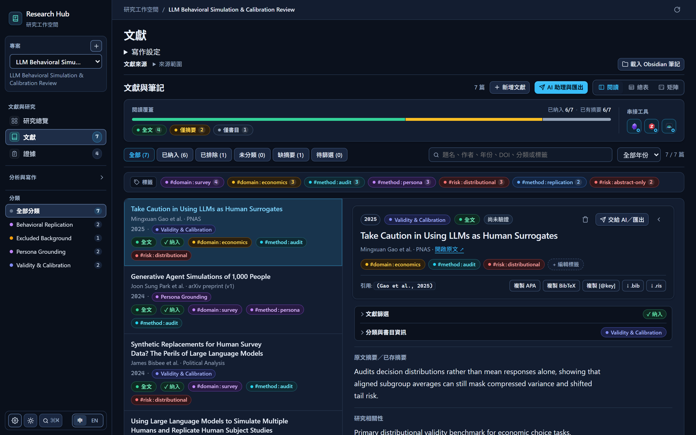
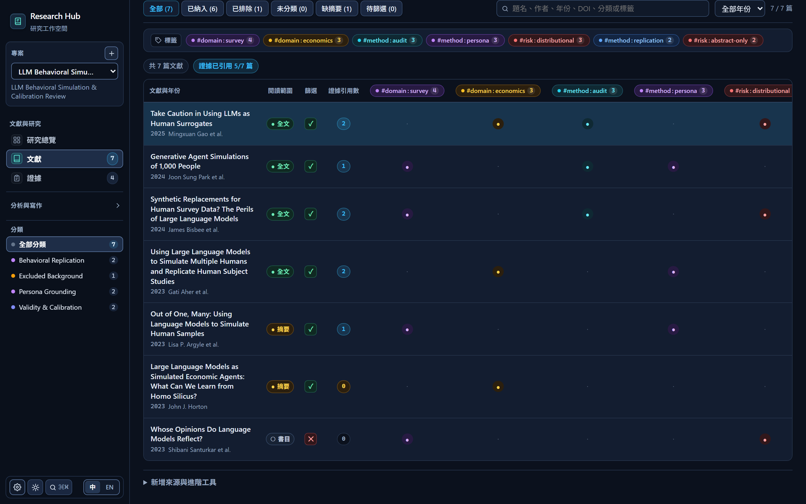
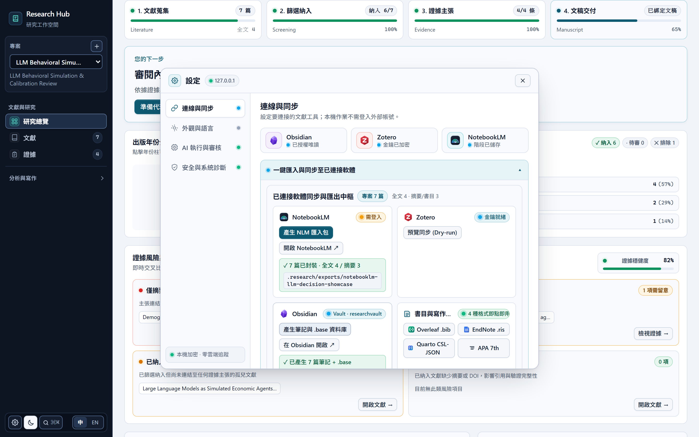
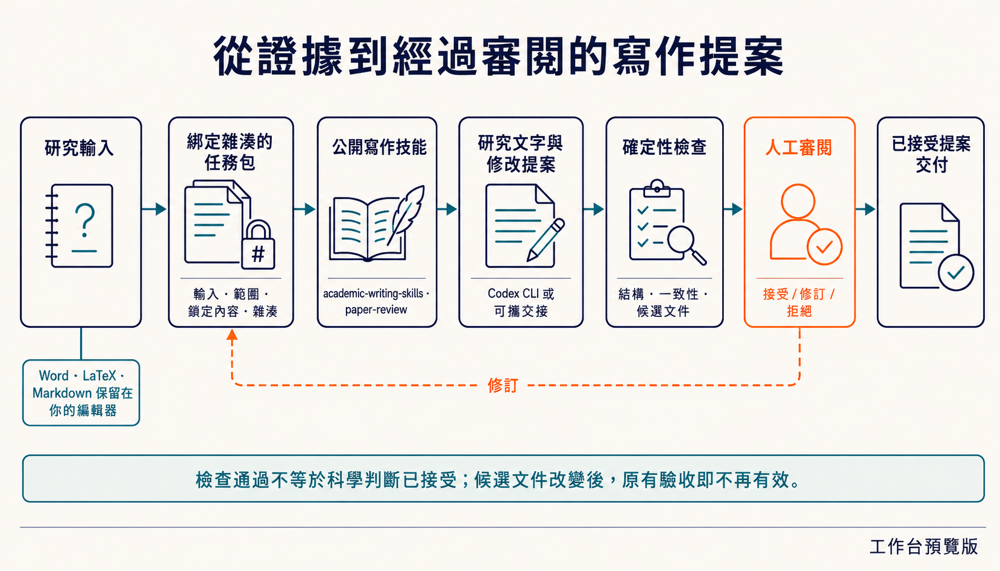

<!-- mcp-name: io.github.WenyuChiou/research-hub -->

# research-hub

**本機優先、證據錨定的研究工作台（Local-First Research Workstation）**：串聯 AI 代理（**Claude Code**、**Codex**、**Gemini**、**Antigravity** ＋ [AI Research Skills](https://github.com/WenyuChiou/ai-research-skills)）與 **Zotero**、**Obsidian（含 Bases）**、**NotebookLM** 及人工審閱的論文草稿。

繁體中文 · [English](README.md) · [工作區指南](docs/workspace-guide.zh-TW.md) · [安裝指南](docs/setup.md) · [開發者架構](docs/workspace-architecture.md)

[](https://pypi.org/project/research-hub-pipeline/) [](pyproject.toml) [](LICENSE)

## 為什麼使用 research-hub？

研究資料常散落於 PDF、Zotero、Obsidian、NotebookLM 與文稿之間。`research-hub` 以本機 SQLite 與 SHA-256 帳本清楚區分**已存書目**、**AI 實際閱讀範圍**與**人類審查決定**，無需雲端綁定即可啟動。


| 核心支柱 | 你獲得的工作台體驗 |
|---|---|
| **誠實揭露證據邊界** | 明確標記閱讀範圍（`全文` · `僅摘要` · `僅書目`）、篩選狀態（`納入` · `排除`）、GitHub 風格 `#domain:*`／`#method:*`／`#risk:*` 標籤與檔案雜湊新鮮度。 |
| **視覺化總覽與盲點雷達** | 掌握四階段研究進度條、年份與覆蓋圖表、**證據盲點雷達**，以及二維 **文獻 × 主題／證據交叉矩陣**。 |
| **免帳號核心 ＋ 三端同步** | 30 秒離線啟動（`research-hub open --demo`）；按需一鍵同步 **Zotero** Collection、匯出 **Obsidian** `.md + .base`、上傳 **NotebookLM**，並輸出 `.bib`／`.ris`／`CSL-JSON`／`APA 7th`。 |
| **互動 AI 助理與人機工學** | 右上角 **`✦ AI 助理`**（`Ctrl+J`／`⌘J`）採「先提案、後確認」寫入，搭配 **淺色／深色／跟隨系統** 主題與 `Ctrl+K`（`⌘K`）命令面板。 |

## 視覺化工作台總覽


| 研究總覽 ＋ 證據盲點雷達 | 深色閱讀工作台 ＋ 一鍵引文 |
|---|---|
|  |  |
| 一眼辨識僅摘要支撐、單一文獻依賴與已納入卻未引用的盲點。 | 檢視閱讀深度、篩選 `#` 結構化標籤，一鍵複製 APA 或 BibTeX 引文。 |
| **文獻 × 主題與證據交叉矩陣** | **分類設定中心 ＋ 同步中樞** |
|  |  |
| 將書目對照閱讀範圍、引用次數與高頻標籤，快速定位研究空白。 | 統一管理加密金鑰、主題切換、即時狀態燈號與 NotebookLM／Zotero／Obsidian 同步。 |

## 選擇你的起點


- **路徑 A — 直接在現有 AI 主機開始（零安裝）：** 載入[可攜式技能](skills/research-hub/)（[技能載入方式](docs/setup.md#installed-skill-files) · [主機支援表](docs/ai-host-support.md)）。不需要安裝 Hub，也不需要 Zotero、Obsidian 或 NotebookLM；Codex MCP 尚未通過版本發布驗證。請試說：「*第一個請求：幫我找 LLM 模擬人類決策的文獻，列出來源連結、相關性、版本與實際讀取範圍。*」預期在主機中取得來源清單並誠實標明未知項目。
- **路徑 B — 開啟 Research Hub 視覺化工作台：** 需 Python 3.10+、Git 及本機瀏覽器。[依下方步驟一鍵啟動](#workspace-preview)，即可瀏覽範例書目、文獻總表與交叉矩陣；選用的[成果保存](docs/contracts/native-discovery-view.md)與[任務交接](docs/workspace-guide.zh-TW.md#writing-adapter-preview)僅寫入選定目的地與授權範圍。

## 安裝與快速開始

<a id="start-here"></a>
<a id="first-run-checklist"></a>
<a id="workspace-preview"></a>

從原始碼安裝即可完整體驗互動式工作台；[PyPI 套件](https://pypi.org/project/research-hub-pipeline/)（`pip install -U research-hub-pipeline`）於 `1.3.0+` 同步提供最新工作台版本。

```sh
git clone -c core.autocrlf=false https://github.com/WenyuChiou/research-hub.git
cd research-hub
```

**macOS / Linux**

```sh
python3 -m venv .venv
./.venv/bin/python -m pip install -e .
./.venv/bin/python -m research_hub open --demo
```

**Windows PowerShell**

```powershell
py -3 -m venv .venv
.\.venv\Scripts\python.exe -m pip install -e .
.\.venv\Scripts\python.exe -m research_hub open --demo
```

`open` 會自動開啟 [http://127.0.0.1:8765/app/](http://127.0.0.1:8765/app/) 並建立 `~/research-hub-workspace`（絕不覆蓋既有資料；可加 `--root`、`--port` 或 `--obsidian-vault`，或改用 `serve --workspace --root ./workspace-demo`）。

**60 秒首次體驗：**

1. 在**專案**選擇 `DEMO: floating-point reading and review outline`（`review-demo`），點左下角 **中** 切換繁體中文。
2. 開啟**文獻**並點選 **What Every Computer Scientist Should Know About Floating-Point Arithmetic**。
3. 確認兩筆種子書目中的 DOI `10.1145/103162.103163` 如實顯示**尚未驗證**、**範圍未知**與**尚未保存摘要**，接著可試用 `#` 標籤、總表、矩陣或 `Ctrl+K`（`⌘K`）。準備管理自己的資料時請見[使用自己的專案](docs/workspace-guide.zh-TW.md#使用自己的專案)。

<details>
<summary>驗證範圍、畫面出處與手動兩步驟啟動</summary>

- **畫面出處：** 上方展示圖擷取自 Windows 11 實機環境（`b2ca1ad`／`45c5fcc`）搭配離線示範資料（`review-demo`、`llm-decision-showcase`）；`summation-demo` 提供數值範例骨架（文獻清單為空）。跨平台 CI 與早期 Linux 實測（`2026-11-07`）詳見[驗證與歷史紀錄](docs/readme-verification-history.md#source-demo-first-task-2026-11-07)。
- **手動兩步驟啟動：** 先執行 `python -m research_hub project demo --root ./workspace-demo --json`，再執行 `python -m research_hub serve --workspace --root ./workspace-demo`。

</details>

<a id="published-dashboard"></a>

<details>
<summary>選用：舊版群組 HTML 儀表板（PyPI 1.2.0）</summary>

```sh
python3 -m venv .dashboard-venv
./.dashboard-venv/bin/python -m pip install research-hub-pipeline==1.2.0
mkdir -p "$HOME/research-hub-preview"
RESEARCH_HUB_ROOT="$HOME/research-hub-preview" ./.dashboard-venv/bin/research-hub dashboard --sample
```

獨立靜態 HTML 儀表板用法請見[安裝指南](docs/setup.md)與[儀表板導覽](docs/dashboard-walkthrough.md)。

</details>

## 六頁工作台與 AI 協作流程

| 頁面 | 在研究流程中的分工 |
|---|---|
| **研究總覽** | 四階段進度條、出版年份直方圖、覆蓋率圓環與**證據盲點雷達**。 |
| **文獻** | **閱讀**、**總表**（`Markdown`／`CSV` 匯出）、**矩陣**、`#` 標籤、APA／BibTeX 複製與唯讀 Obsidian 筆記快照。 |
| **證據** | 將研究主張綁定至已登錄來源 ID，提前標出僅摘要或單一來源缺口。 |
| **設計與結果** | 記錄研究方法、實測結果、限制與 SHA-256 追蹤之分析產物。 |
| **論文** | 追蹤 **Word**、**LaTeX** 或 **Markdown** 稿件、輸入雜湊變動與章節修訂大綱。 |
| **審閱與交付** | 審核 AI 寫作提案、記錄人類接受／修訂決定並打包經核准之本機 ZIP。 |



| AI 協作模式 | 人類審查與邊界保證 |
|---|---|
| **可攜式交接** | 將雜湊鎖定的任務封包匯出至 Claude、Codex 或 Antigravity，候選文字匯回 `awaiting_human` 待審。 |
| **連接 Codex／AI 助理** | 透過 `Ctrl+J` 對話或受控寫作提出整理與草稿提案；每筆變更皆須人工確認才生效。 |

<details>
<summary>證據邊界、原生七段摘要與交付說明</summary>

- **不越權宣稱：** DOI 可解析絕不等於支持科學主張；未明確讀取的 PDF 與並列翻譯絕不自動視為已讀。
- **原生七段摘要與閱讀器：** 搭配 [paper-summarize](skills/paper-summarize/) 與[摘要 CLI](docs/cli-reference.md#native-authored-source-summaries)（`native-summary-context`／`native-summary-import`，詳見[摘要契約](docs/native-source-summary.md)），以及[原生閱讀器匯出指南](src/research_hub/skills_data/research-hub/references/native-discovery-export.md)。
- **受控本機交付：** 已核准提案僅於另行確認後打包為本機 ZIP（[寫作設定](docs/workspace-guide.zh-TW.md#writing-adapter-preview) · [MCP／REST 整合](docs/ai-integrations.md)）。

</details>

## 選用整合與文件索引

<a id="connect-your-ai-host"></a>

| 整合項目 | 快速設定（`⚙ 設定` 或 CLI） | 連接後的一鍵操作與輸出 |
|---|---|---|
| **Zotero** | 加密儲存 `ZOTERO_LIBRARY_ID` ＋ `ZOTERO_API_KEY`（優先覆蓋環境變數） | **Dry-run 去重預覽** → 自動建立／歸入 `[Research Hub] <專案名稱>` Collection |
| **Obsidian（＋ Bases）** | 帶入 `--obsidian-vault` 或於**設定**填寫 Vault 路徑（單一設定兼做唯讀驗證與瀏覽） | 於 `.research/exports/` 產生 `.md` ＋ `.base` 資料庫檢視並以 `obsidian://` 開啟 |
| **NotebookLM** | 執行 `notebooklm login --auto-detect` 或匯入 `state.json` | 封裝限定來源包並一鍵 **`☁ 上傳至 NotebookLM`**（產生 `upload_receipt.json`） |
| **AI 助理與 MCP** | 按 `Ctrl+J`（`⌘J`）或掛載 [MCP／REST](docs/ai-integrations.md) | 對話提案增刪／復原文獻與加 `#` 標籤，或匯出 **APA / BibTeX / RIS / CSL** |

<a id="credential-reference"></a>
<details>
<summary>環境變數與選用套件擴充（`research-hub doctor`）</summary>

執行 `research-hub doctor` 可逐項健檢已設定連線。人物角色選用擴充：`[playwright,secrets]`（Researcher／Humanities）或 `[import,secrets]`（Analyst／Internal KM）。

<!-- env-vars-table-start -->

| 名稱 | 必要性 | 用途 |
|---|---|---|
| `ZOTERO_API_KEY` | 僅 Zotero | Zotero API 驗證 |
| `ZOTERO_LIBRARY_ID` | 僅 Zotero | Zotero 文獻庫識別碼 |
| `SEMANTIC_SCHOLAR_API_KEY` | 否 | 選用搜尋 API key |
| `SEMANTIC_SCHOLAR_RPS` | 否 | 選用搜尋請求頻率設定 |
| `TAVILY_API_KEY` | 否 | 選用網路搜尋服務 |
| `BRAVE_API_KEY` | 否 | 選用網路搜尋服務 |

<!-- env-vars-table-end -->

</details>

- **使用手冊：** [工作區指南](docs/workspace-guide.zh-TW.md) · [工作區架構](docs/workspace-architecture.md) · [CLI 參考](docs/cli-reference.md) · [MCP 工具](docs/mcp-tools.md) · [穩定 API](docs/stable-api.md) · [能力基線](docs/capability-baseline.md)
- **版本與貢獻：** [版本紀錄](CHANGELOG.md) · [升級指南](UPGRADE.md) · [驗證與歷史紀錄](docs/readme-verification-history.md) · [參與開發](CONTRIBUTING.md) · [發布流程](docs/RELEASING.md) · [MIT 授權](LICENSE)
