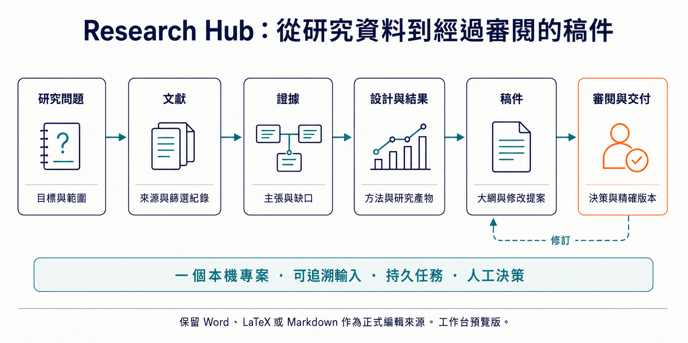
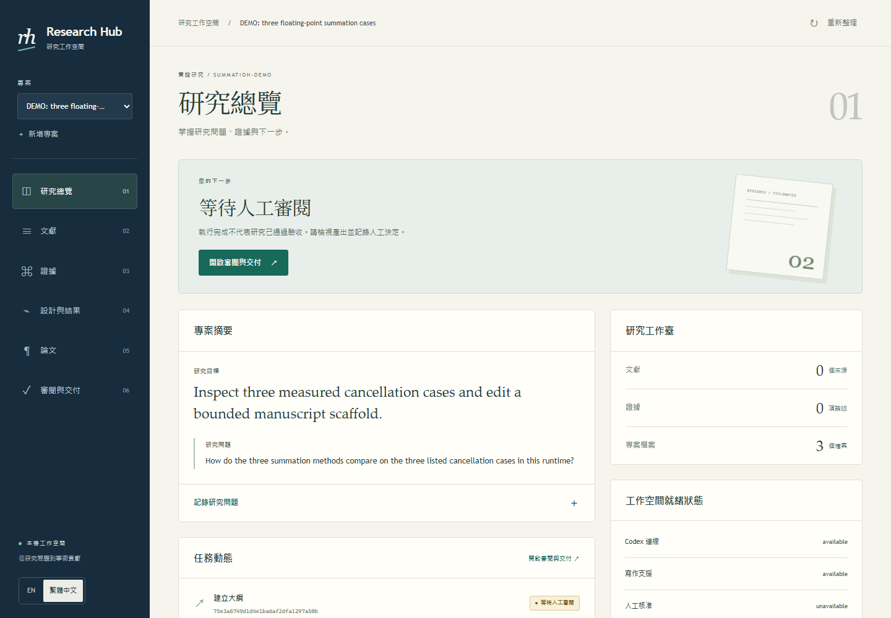
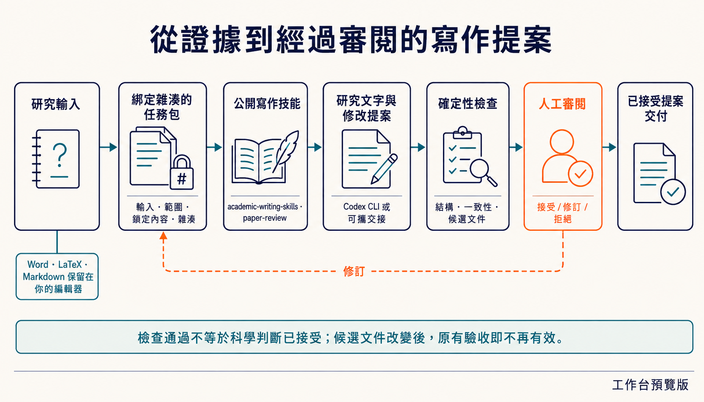

<!-- mcp-name: io.github.WenyuChiou/research-hub -->

# research-hub

給研究者的本機工作區：整理文獻、證據與稿件，並由你審查 AI 提案。

繁體中文 · [English](README.md) · [工作區指南](docs/workspace-guide.zh-TW.md) · [安裝指南](docs/setup.md) · [開發者架構](docs/workspace-architecture.md)

[](https://pypi.org/project/research-hub-pipeline/) [](pyproject.toml) [](LICENSE)

## 為什麼使用 research-hub？

研究散落在文獻、筆記、分析結果和稿件之間。一篇論文可能影響研究問題，一份資料更新可能讓某個結論或稿件段落需要重新檢視。research-hub 提供本機工作區，讓研究者與 AI 助理能記錄這些關聯、交接任務，並在採納提案前進行人工審查。

- **保留脈絡：** 將研究問題、來源、證據、結果與稿件放在同一個專案中，而不只留在對話歷史裡。
- **追蹤變動：** 登錄檔案路徑與檔案指紋（hash），協助辨識檔案是否改變，再檢視可能需要重新審查的工作。
- **保留決策權：** AI 工作產生的提案要經人工檢視；本機交付也需要另行核准。



<a id="start-here"></a>
<a id="first-run-checklist"></a>

## 安裝與快速開始

<a id="workspace-preview"></a>

### 在本機試用工作區

建議先試用下方工作區；如果只想看已發布的舊版文獻儀表板，再看下面的選項。

需要 Python 3.10+ 與 Git。以下從原始碼安裝工作區，並在**新建或空白的** `workspace-demo` 目錄建立示範資料。這條路徑與 PyPI 發布套件不同：套件版本號不保證包含目前原始碼的工作區功能。

```sh
git clone -c core.autocrlf=false https://github.com/WenyuChiou/research-hub.git
cd research-hub
git fetch origin c1ab382e1bc4bfdb1d5df6a230d1ab4509a50d2a
git checkout --detach c1ab382e1bc4bfdb1d5df6a230d1ab4509a50d2a
```

依作業系統選一組指令。這裡直接呼叫虛擬環境的 Python，不需要啟用腳本或變更 PowerShell 執行原則。安裝相依套件需要網路。

**macOS / Linux**

```sh
python3 -m venv .venv
./.venv/bin/python -m pip install -e .
./.venv/bin/python -m research_hub project demo --root ./workspace-demo --json
./.venv/bin/python -m research_hub serve --workspace --root ./workspace-demo
```

**Windows PowerShell**

一個 Windows 測試環境使用較早的 `14ddc070` 原始碼建立示範時遇到 `WinError 5`，原因尚未確定。請參閱[驗證與環境紀錄](docs/readme-verification-history.md)。

```powershell
py -3 -m venv .venv
.\.venv\Scripts\python.exe -m pip install -e .
.\.venv\Scripts\python.exe -m research_hub project demo --root ./workspace-demo --json
.\.venv\Scripts\python.exe -m research_hub serve --workspace --root ./workspace-demo
```

開啟 [http://127.0.0.1:8765/app/](http://127.0.0.1:8765/app/)。示範包含兩個教學專案。開啟後可選 **繁體中文**，再在**專案**下拉選單中，選擇 `DEMO: three floating-point summation cases`（`summation-demo`，浮點加總範例）或 `DEMO: floating-point reading and review outline`（`review-demo`，文獻回顧範例），再開啟**文獻**看看文獻頁面。這些是教學輸入，不是研究發現，也不需要帳號。使用完畢後按 `Ctrl+C` 停止前景伺服器。

使用自己的檔案，請直接前往[使用自己的專案](docs/workspace-guide.zh-TW.md#使用自己的專案)；指南中較早的安裝固定版本是歷史紀錄。

<a id="published-dashboard"></a>

<details>
<summary>選用：試用已發布的舊版文獻儀表板</summary>

[PyPI 套件](https://pypi.org/project/research-hub-pipeline/)提供較早的文獻儀表板，不是較新的原始碼工作區。若要試用免帳號範例，以下獨立虛擬環境與空白根目錄的方式已在 Linux、Python 3.12 測試：

```sh
python3 -m venv .dashboard-venv
./.dashboard-venv/bin/python -m pip install research-hub-pipeline==1.2.0
mkdir -p "$HOME/research-hub-preview"
RESEARCH_HUB_ROOT="$HOME/research-hub-preview" ./.dashboard-venv/bin/research-hub dashboard --sample
```

請在 HOME 下使用新建或空白的 `research-hub-preview` 目錄：指令會在其中建立 `.research_hub` 與 `logs`。程式會印出產生的暫存 HTML 路徑；請在瀏覽器開啟該路徑。在乾淨 HOME 未設定根目錄時，直接執行 `dashboard --sample` 曾失敗；平台與瀏覽器的限制見[驗證紀錄](docs/readme-verification-history.md)。若要連接實際服務，請參閱[安裝指南](docs/setup.md)、[儀表板導覽](docs/dashboard-walkthrough.md)與[前十分鐘](docs/first-10-minutes.md)。

</details>

## 在工作區做什麼



*歷史示範畫面，於 2026-09-08 審視；目前介面可能不同。*

| 頁面 | 使用範例 |
|---|---|
| 研究總覽 | 檢視研究問題、目標與專案脈絡。 |
| 文獻 | 收集來源，記錄納入或排除的理由。 |
| 證據 | 將主張連到來源，檢視尚未確認的支持關係。 |
| 設計與結果 | 記錄方法、結果、限制與佐證檔案。 |
| 論文 | 登錄 Word、LaTeX 或 Markdown，準備大綱與修訂。 |
| 審閱與交付 | 檢視提案、記錄決定，準備本機交付檔。 |

原始檔仍由你的編輯器修改；工作區登錄的是檔案路徑與雜湊。識別碼能解析不代表來源支持某項主張，請自行查核證據及科學判斷。

## 從文獻探索開始

在能載入 research-hub 技能、並有搜尋與閱讀工具的相容 AI 工具（AI 主機）中，可先提出具體需求，例如：

> 幫我找 LLM 模擬人類決策的文獻，列出原文連結、相關性、版本與可取得的全文限制。

接著可要求「聚焦經濟決策，比較真人基準與評估方法」。先檢視來源、可讀範圍與未解問題，再決定下一步。搜尋摘要不等於全文閱讀。此研究方式可獨立於 Hub 使用；Zotero、Obsidian、NotebookLM 與 Hub 儲存都不是先決條件。要使用 Hub 的視覺工作區或儲存功能，則需要安裝並啟動 Hub。

Native reader 可整理提供的研究摘要、來源索引與書目，也可附上明確提供的 PDF。PDF 僅原封複製並提供下載；這不代表它已被解析、翻譯、驗證或全文閱讀。原生閱讀器可將使用者提供的翻譯與原始觀察並列，並標示為未經驗證；閱讀器不會產生翻譯或驗證翻譯的準確性。提供翻譯的格式請見[原生閱讀器匯出指南](src/research_hub/skills_data/research-hub/references/native-discovery-export.md)。

更多 skill 與 AI 主機安裝方式，見 [AI Research Skills](https://github.com/WenyuChiou/ai-research-skills)、[AI 主機支援表](docs/ai-host-support.md)及 [MCP／REST 整合](docs/ai-integrations.md)。可選的 Hub 結果儲存與檢視邊界見[已儲存成果契約](docs/contracts/native-discovery-view.md)。

## 寫作、審查與交付



| 模式 | 工作方式 |
|---|---|
| 可攜式交接 | 匯出任務到 AI 主機，再匯入文字與候選檔案雜湊。匯出後任務等待代理回覆。 |
| 連接 Codex | 經登入且相容的 Codex CLI，使用明確信任的公開寫作套件產生文字，結果等待人工審查。 |

[寫作設定](docs/workspace-guide.zh-TW.md#writing-adapter-preview)說明選用介接器的驗證及設定。連接的 Codex 接收有限長度的文字摘錄，不接收二進位文件內容。Word 格式、LaTeX 編譯和最終文件修改仍在你的編輯器完成。已接受的提案可經另一次核准打包成本機 ZIP；這不授權投稿或雲端上傳。工作區核准也不自動涵蓋既有 CLI、MCP、儀表板及雲端直接寫入工具。[邊界與復原指南](docs/workspace-guide.zh-TW.md#boundaries-and-recovery)列出細節。

<a id="credential-reference"></a>
<a id="connect-your-ai-host"></a>

## 選用整合

- **Zotero：** 管理文獻；連線工作流程需要 API key 和 library ID。
- **Obsidian：** 在本機 vault 中整理筆記，也可先使用本機檔案。
- **NotebookLM：** 用來源資料製作摘要；需要瀏覽器登入與可用的工作階段。請參閱[設定](docs/notebooklm.md)與[疑難排解](docs/notebooklm-troubleshooting.md)。
- **AI 主機：** 透過 [MCP／REST](docs/ai-integrations.md) 或可攜式 skills 連接；MCP 安裝需要額外的 `[mcp]` 套件。

依需要選擇整合，執行 `./.venv/bin/python -m research_hub doctor`（macOS／Linux）或 `.\.venv\Scripts\python.exe -m research_hub doctor`（Windows PowerShell），逐項查看結果；設定或安裝成功不代表每個服務都已驗證。[安裝指南](docs/setup.md)列出選用套件及憑證；另見[本機檔案匯入](docs/import-folder.zh-TW.md)、[EZproxy](docs/ezproxy.md)與[實際連線檢查表](docs/live-smoke.md)。

<details>
<summary>整合憑證與選用套件</summary>

本機工作區示範不需要這些憑證。既有人物角色的選用套件：Researcher 與 Humanities 使用 `[playwright,secrets]`；Analyst 與 Internal KM 使用 `[import,secrets]`。

<!-- env-vars-table-start -->

| 名稱 | 必要性 | 用途 |
|---|---|---|
| `ZOTERO_API_KEY` | 僅 Zotero | Zotero API 驗證 |
| `ZOTERO_LIBRARY_ID` | 僅 Zotero | Zotero 文獻庫識別碼 |
| `SEMANTIC_SCHOLAR_API_KEY` | 否 | 選用搜尋 API key |
| `SEMANTIC_SCHOLAR_RPS` | 否 | 選用搜尋請求頻率設定 |
| `TAVILY_API_KEY` | 否 | 選用網路搜尋服務 |
| `BRAVE_API_KEY` | 否 | 選用網路搜尋服務 |

<!-- env-vars-table-end -->

</details>

## 文件與貢獻

- [工作區指南](docs/workspace-guide.zh-TW.md) · [工作區架構](docs/workspace-architecture.md) · [能力基線](docs/capability-baseline.md) · [驗證紀錄](docs/readme-verification-history.md)
- [CLI 參考](docs/cli-reference.md) · [MCP 工具](docs/mcp-tools.md) · [穩定 API](docs/stable-api.md) · [檔案格式](docs/file-formats.md) · [工作流程執行架構](docs/workflow-runtime.md) · [OpenWiki](openwiki/quickstart.md)
- [既有儀表板操作錄影](docs/images/dashboard-walkthrough.gif) · [完整解析度影片](docs/demo/dashboard-walkthrough.mp4) · [MCP 流程圖](docs/images/research-hub-cover.png)
- [參與開發](CONTRIBUTING.md) · [版本紀錄](CHANGELOG.md) · [發布流程](docs/RELEASING.md) · [MIT 授權](LICENSE)
