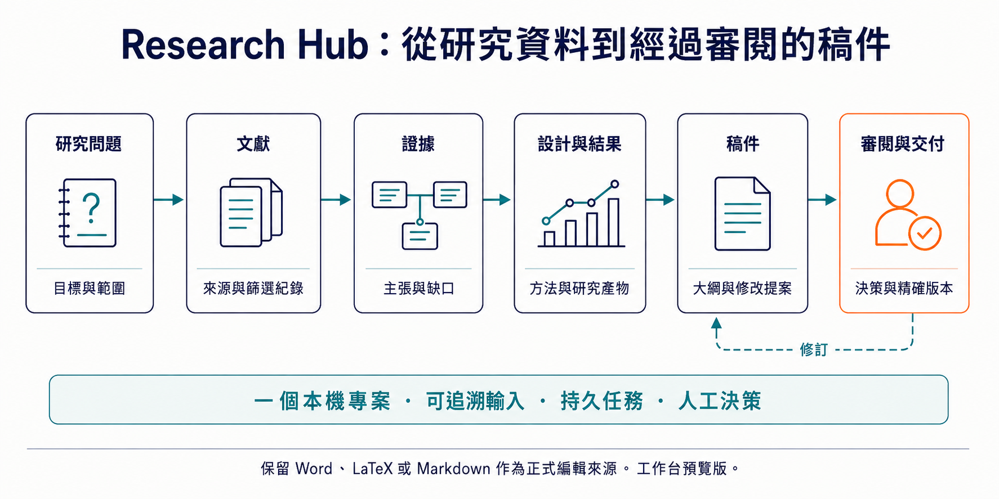
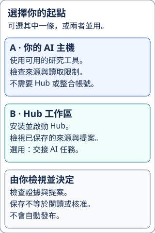

<!-- mcp-name: io.github.WenyuChiou/research-hub -->

# research-hub

給研究者的本機工作區：串聯 AI 助理（Claude Code、Codex）與 **Zotero** 文獻狀態、**Obsidian** 筆記、**NotebookLM** 來源簡報及人工審查的論文草稿。

繁體中文 · [English](README.md) · [工作區指南](docs/workspace-guide.zh-TW.md) · [安裝指南](docs/setup.md) · [開發者架構](docs/workspace-architecture.md)

[](https://pypi.org/project/research-hub-pipeline/) [](pyproject.toml) [](LICENSE)

## 為什麼使用 research-hub？

文獻探索發生在 AI 助理對話中，而真正的研究工作則分散在 Zotero 文獻庫、Obsidian 筆記、NotebookLM 簡報、分析腳本與論文稿件之間。`research-hub` 將這些環節整合成單一可檢視的本機工作區，並與 [AI Research Skills](https://github.com/WenyuChiou/ai-research-skills) 搭配支援 Stage 1–2 的探索到整理流程：

- **建築在你的 AI 主機原生搜尋上：** 由 Claude Code 或 Codex 使用其原生搜尋與閱讀工具找文獻、讀原文，不強迫先經過獨立關鍵字腳本。
- **一眼掌握 Zotero、Obsidian 與 NotebookLM 狀態：** 檢視 Zotero 收錄狀態、將結構化筆記或七段來源綁定摘要寫入 Obsidian 主題群組，並打包已驗證來源送入 NotebookLM。
- **追蹤變動與保留人類決策權：** 登錄本機檔案雜湊以偵測需要重審的證據或稿件段落；所有 AI 提案與寫入都必須先經人工核准。



## 選擇你的起點



1. **直接在現有 AI 主機開始（免裝 Hub）：**
   - **前置條件：** 需要可用的搜尋與閱讀工具，以及[可攜式技能與參考檔案](skills/research-hub/)。不需要安裝 Hub，也不需要 Zotero、Obsidian 或 NotebookLM。請見[技能載入方式](docs/setup.md#installed-skill-files)與[主機支援表](docs/ai-host-support.md)；Codex MCP 尚未通過版本發布驗證。
   - **第一個請求：**「幫我找 LLM 模擬人類決策的文獻，列出來源連結、相關性、版本及實際讀取範圍。」
   - **預期成果：** 預期在主機中取得來源清單，明列未知資訊與不可用的工具或來源，不自動宣稱全文已讀，也不會未經要求寫入檔案。

2. **使用 Hub 工作區（保存書目、整合三端與視覺化檢視）：**
   - **前置條件：** Python 3.10+、Git 及本機瀏覽器。
   - [依下方已測試的示範安裝並啟動](#workspace-preview)，檢視兩筆種子書目及其讀取限制。選用的[成果保存](docs/contracts/native-discovery-view.md)與[任務交接](docs/workspace-guide.zh-TW.md#writing-adapter-preview)需要選定目的地與授權。

<a id="start-here"></a>
<a id="first-run-checklist"></a>

## 安裝與快速開始

<a id="workspace-preview"></a>

### 在本機試用工作區

使用以下原始碼安裝步驟，在**新建或空白的** `workspace-demo` 目錄啟動本機互動工作區。原始碼工作區與 [PyPI 套件](https://pypi.org/project/research-hub-pipeline/)為不同發布線，套件版本號不代表包含最新原始碼功能。

```sh
git clone -c core.autocrlf=false https://github.com/WenyuChiou/research-hub.git
cd research-hub
git fetch origin 1f0726a7e92a1231e633963f17236a2f5c1eab8f
git checkout --detach 1f0726a7e92a1231e633963f17236a2f5c1eab8f
```

依作業系統選擇以下指令（直接呼叫虛擬環境 Python，無需啟用腳本；安裝相依套件需連線網路）：

**macOS / Linux**

```sh
python3 -m venv .venv
./.venv/bin/python -m pip install -e .
./.venv/bin/python -m research_hub project demo --root ./workspace-demo --json
./.venv/bin/python -m research_hub serve --workspace --root ./workspace-demo
```

**Windows PowerShell**

```powershell
py -3 -m venv .venv
.\.venv\Scripts\python.exe -m pip install -e .
.\.venv\Scripts\python.exe -m research_hub project demo --root ./workspace-demo --json
.\.venv\Scripts\python.exe -m research_hub serve --workspace --root ./workspace-demo
```

**第一個任務：檢視已保存的來源及其讀取限制。**

1. 開啟 [http://127.0.0.1:8765/app/](http://127.0.0.1:8765/app/)，選 **繁體中文**，再在**專案**選擇 `DEMO: floating-point reading and review outline`（`review-demo`）。
2. 開啟**文獻**，選取 **What Every Computer Scientist Should Know About Floating-Point Arithmetic**。
3. 清單應有兩筆種子書目。所選來源會顯示 DOI `10.1145/103162.103163`、**尚未驗證**、**範圍未知**及**尚未保存摘要**。這是預期的示範狀態：沒有下載或摘要全文，附帶的篩選決定只是範例，不是你的審查結果。

使用期間請保持終端機執行（按 `Ctrl+C` 停止）；之後重啟只需執行 `serve --workspace --root ./workspace-demo`。要管理自己的檔案，請見[使用自己的專案](docs/workspace-guide.zh-TW.md#使用自己的專案)。

<details>
<summary>驗證範圍、環境備註與第二個示範專案</summary>

- **已驗證範圍：** 本次於 Linux、Python 3.12.14 以原始碼版本 `1f0726a7` 檢查示範建立、啟動及上述雙語任務；不代表已驗證 Windows、macOS 或全新相依套件安裝。詳見[確切驗證範圍](docs/readme-verification-history.md#source-demo-first-task-2026-11-07)。
- **Windows 歷史備註：** 一個 Windows 測試環境使用較早的 `14ddc070` 原始碼建立示範時遇到 `WinError 5`，原因尚未確定；請參閱[驗證與環境紀錄](docs/readme-verification-history.md)。勿在已保存工作上重建示範；若建立中斷，請改用另一個全新空白目錄。
- **第二個種子專案：** `DEMO: three floating-point summation cases`（`summation-demo`）包含數值範例與稿件骨架，文獻清單為空；兩個示範都不需要帳號。

</details>

<a id="published-dashboard"></a>

<details>
<summary>選用：試用已發布的舊版文獻儀表板（PyPI 1.2.0）</summary>

[PyPI 套件](https://pypi.org/project/research-hub-pipeline/)提供較早的文獻群組儀表板，而非新版原始碼工作區。以下方式已在 Linux、Python 3.12 搭配空白 `RESEARCH_HUB_ROOT` 目錄測試：

```sh
python3 -m venv .dashboard-venv
./.dashboard-venv/bin/python -m pip install research-hub-pipeline==1.2.0
mkdir -p "$HOME/research-hub-preview"
RESEARCH_HUB_ROOT="$HOME/research-hub-preview" ./.dashboard-venv/bin/research-hub dashboard --sample
```

在瀏覽器開啟程式印出的暫存 HTML 路徑。服務設定與平台限制請見[安裝指南](docs/setup.md)、[儀表板導覽](docs/dashboard-walkthrough.md)與[驗證紀錄](docs/readme-verification-history.md)。

</details>

## 在工作區做什麼


*歷史示範畫面，於 2026-09-08 審視；目前介面可能不同。*

| 頁面 | 使用範例 |
|---|---|
| 研究總覽 | 檢視研究問題、目標與專案脈絡。 |
| 文獻 | 收集來源，記錄納入或排除的理由。 |
| 證據 | 將主張連到來源，檢視尚未確認的支持關係。 |
| 設計與結果 | 記錄方法、結果、限制與佐證檔案。 |
| 論文 | 登錄 Word、LaTeX 或 Markdown，準備大綱與修訂。 |
| 審閱與交付 | 檢視提案、記錄決定，準備本機交付檔。 |

原始檔仍由你的編輯器修改；工作區只追蹤檔案路徑與雜湊。識別碼能解析不等於來源支持某項主張，請自行核對原始證據與科學判斷。

## 探索、整理與驗證文獻

當你將 [research-hub 技能](skills/research-hub/)載入相容的 AI 主機（如 Claude Code 或 Codex）時，讓主機負責找與讀、讓 Research Hub 負責確定性儲存與三端串接：

- **第一步 — 由 AI 主機原生找與讀：** 直接請主機搜尋、追引文並閱讀可取得的原文段落（例如：「幫我找 LLM 模擬人類決策的文獻，列出原文連結、相關性、版本與可取得的全文限制」）。搜尋片段不等於全文閱讀。
- **第二步 — 同步 Zotero 狀態與寫入 Obsidian：** 取得書目清單後，經 `--dry-run` 預覽授權 `research-hub ingest` 以核對 **Zotero** 狀態並產出 **Obsidian** 主題筆記，或透過 `project record` 保存本機專案書目中繼資料。
- **第三步 — 匯出精讀摘要與驗證 NotebookLM 簡報：** 使用 `paper-summarize` 產出七段來源綁定摘要（可匯出成 Obsidian／Roam Markdown），再用 `research-hub notebooklm` 搭配 `notebooklm-brief-verifier` 產生與查核簡報，最後交接給 `literature-triage-matrix` 與 `gap-to-topic`。

<details>
<summary>原生閱讀器邊界與來源摘要版本界線說明</summary>

- **原生閱讀器邊界：** 僅呈現呼叫者提供的觀察、書目、原封附帶的 PDF 下載，以及明確標示「未經驗證」的並列翻譯；不會自動解析、翻譯或做科學驗證。格式請見[原生閱讀器匯出指南](src/research_hub/skills_data/research-hub/references/native-discovery-export.md)與選用的[已儲存成果契約](docs/contracts/native-discovery-view.md)。
- **七段摘要 CLI 版本界線：** 快速開始的 `1f0726a7` 示範早於 Stage 1 來源摘要功能。自原始碼 `231f9fbd` 起，[已撰寫來源摘要 CLI](docs/cli-reference.md#native-authored-source-summaries)可保存與匯出綁定當前來源雜湊的七段摘要；使用前請先閱讀[摘要契約](docs/native-source-summary.md)，並分開核對原始碼修訂版與實際安裝入口。

</details>

更多細節請見 [AI Research Skills](https://github.com/WenyuChiou/ai-research-skills)、[AI 主機支援表](docs/ai-host-support.md)與 [MCP／REST 整合](docs/ai-integrations.md)。

## 寫作、審查與交付


| 模式 | 工作方式 |
|---|---|
| 可攜式交接 | 匯出任務到 AI 主機，再匯入文字與候選檔案雜湊。匯出後任務等待代理回覆。 |
| 連接 Codex | 經登入且相容的 Codex CLI，使用明確信任的公開寫作套件產生文字，結果等待人工審查。 |

請參閱[寫作設定](docs/workspace-guide.zh-TW.md#writing-adapter-preview)與[邊界與復原指南](docs/workspace-guide.zh-TW.md#boundaries-and-recovery)。連接的 Codex 僅接收有限長度的文字摘錄而不含二進位檔；最終排版仍在編輯器完成，且本機 ZIP 交付需另行核准，不授權雲端上傳或覆蓋既有直接寫入工具。

<a id="credential-reference"></a>
<a id="connect-your-ai-host"></a>

## 選用整合

- **Zotero：** 追蹤文獻與分類收錄狀態（需 `ZOTERO_API_KEY` 與 `ZOTERO_LIBRARY_ID`）。
- **Obsidian：** 在本機 vault 中整理主題群組筆記、精讀摘要與綜合總覽（也可先用純本機 Markdown）。
- **NotebookLM：** 依主題打包上傳來源、製作簡報並反向核對主張（需瀏覽器工作階段；見[設定](docs/notebooklm.md)與[疑難排解](docs/notebooklm-troubleshooting.md)）。
- **AI 主機：** 透過 [MCP／REST](docs/ai-integrations.md)（需 `[mcp]`）或依[安裝指南](docs/setup.md)載入可攜式 skills。

執行 `./.venv/bin/python -m research_hub doctor`（macOS／Linux）或 `.\.venv\Scripts\python.exe -m research_hub doctor`（Windows PowerShell）可逐項檢查已設定的目的地。另見[本機檔案匯入](docs/import-folder.zh-TW.md)、[EZproxy](docs/ezproxy.md)與[實際連線檢查表](docs/live-smoke.md)。

<details>
<summary>整合憑證與選用套件</summary>

本機工作區示範不需要這些憑證。既有人物角色的選用套件：Researcher 與 Humanities 使用 `[playwright,secrets]`；Analyst 與 Internal KM 使用 `[import,secrets]`。

<!-- env-vars-table-start -->

| 名稱 | 必要性 | 用途 |
|---|---|---|
| `ZOTERO_API_KEY` | 僅 Zotero | Zotero API 驗證 |
| `ZOTERO_LIBRARY_ID` | 僅 Zotero | Zotero 文獻庫識別碼 |
| `SEMANTIC_SCHOLAR_API_KEY` | 否 | 選用搜尋 API key |
| `SEMANTIC_SCHOLAR_RPS` | 否 | 選用搜尋請求頻率設定 |
| `TAVILY_API_KEY` | 否 | 選用網路搜尋服務 |
| `BRAVE_API_KEY` | 否 | 選用網路搜尋服務 |

<!-- env-vars-table-end -->

</details>

## 文件與貢獻

- [工作區指南](docs/workspace-guide.zh-TW.md) · [工作區架構](docs/workspace-architecture.md) · [能力基線](docs/capability-baseline.md) · [驗證紀錄](docs/readme-verification-history.md)
- [CLI 參考](docs/cli-reference.md) · [MCP 工具](docs/mcp-tools.md) · [穩定 API](docs/stable-api.md) · [檔案格式](docs/file-formats.md) · [工作流程執行架構](docs/workflow-runtime.md) · [OpenWiki](openwiki/quickstart.md)
- [既有儀表板操作錄影](docs/images/dashboard-walkthrough.gif) · [完整解析度影片](docs/demo/dashboard-walkthrough.mp4) · [MCP 流程圖](docs/images/research-hub-cover.png)
- [參與開發](CONTRIBUTING.md) · [版本紀錄](CHANGELOG.md) · [發布流程](docs/RELEASING.md) · [MIT 授權](LICENSE)
